# 电算Phase1产品需求文档V1.0

## 第 1 章｜文档基础与范围

### 1.1 背景与目标

本项目在客户环境内部署 LLMOCR，沿用农林水产产品的帳票配置、识别、组织、用户和权限功能。本期定制文件一览、自动取入和 CSV 导出，并将登录账号改为用户ID。每个租户独立部署应用环境，共用 GPU 识别服务。

### 1.2 本期交付范围

| 模块 | 交付性质 | 本期范围 |
| --- | --- | --- |
| 文件一览 | 定制 | 业务场景／帳票类别目录、文件夹权限联动、目录显示名调整、筛选、排序与批量导出 |
| 自动取入 | 全新定制 | 监视与处理后路径、组织目录递归扫描、自动分类与读取、去重、失败重试、错误记录 |
| 帳票类别 | 局部定制 | 仅定制导出配置与执行规则；类别配置、OCR抽出等复用 |
| 业务场景 | 复用 | 选择部门与用户的数据授权、场景关联类别、类别访问控制 |
| 权限管理 | 复用与适配 | 复用角色与菜单授权，调整为本项目菜单及管理子项 |
| 部门与用户 | 复用与适配 | 复用组织层级、用户管理和个人角色分配；用户单一组织归属 |
| 登录 | 适配 | 用户ID＋密码登录，替换邮箱登录 |
| 安全设定 | 复用 | 沿用农林水产产品的安全设置 |
| 辞书 | 复用 | 沿用既有辞书与向量化能力 |
| 日志 | 局部适配 | 复用认证／操作日志，查询标识使用用户ID；系统自动取入事件不进入操作日志 |
| Home | 复用 | 沿用现有利用履历与计费能力 |
| 部署与架构 | 技术实施 | 每租户专属 VM、数据隔离、共享 GPU、多租户任务队列 |

截图用于说明页面布局和操作入口。

## 第 2 章｜数据结构与状态

### 2.1 实体与关系

- 租户拥有各自的用户、组织、业务场景、类别配置、文件、处理任务和日志。
- 组织构成树形结构。每个用户只属于一个直属组织；上级组织查看范围可包含下级用户，成员关系始终记录直属组织。
- 用户可持有多个角色，角色授予菜单权限。菜单权限根据用户持有的角色计算。
- 业务场景关联帳票类别，并保存授权组织。选择组织后，默认包含该组织及下级组织的全部成员。
- 文件属于租户和帳票类别。文件一览按类别所属场景的授权范围显示文件。
- 每个租户 VM 配置一条监视路径和一条处理后路径。每条取入配置保存组织ID、组织文件夹相对路径和业务场景；组织文件夹下的目录统一递归扫描。物理目录不与帳票类别绑定。
- 导出配置属于帳票类别。配置包括输出列、列顺序、文本与表格字段映射、表格展开上限，以及编码和文件命名设置。

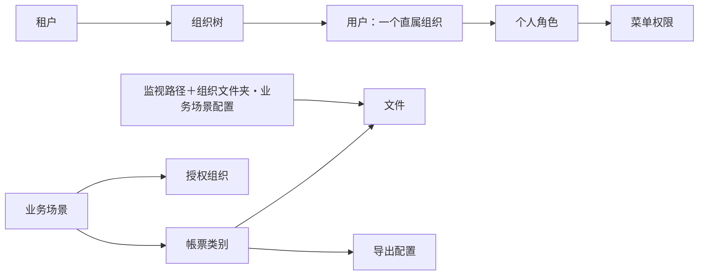

#### 组织、权限与自动取入的联动

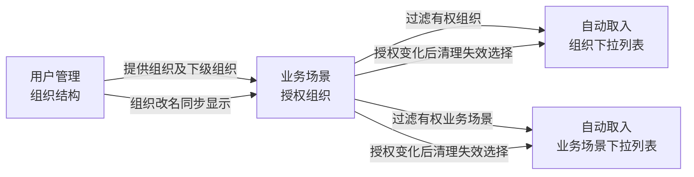

| 来源 | 影响对象 | 联动规则 |
| --- | --- | --- |
| 用户管理组织结构 | 业务场景授权组织、自动取入组织候选 | 组织改名同步显示；删除或变更后重新校验关联配置 |
| 业务场景授权组织 | 自动取入组织候选 | 仅显示当前用户有权配置的组织及其下级组织 |
| 业务场景关联类别与授权 | 自动取入业务场景候选 | 仅显示该组织可使用的业务场景；失去授权的已选项自动清除 |

## 第 3 章｜用户交互流程

### 3.1 入口与职责

管理员配置组织、用户、角色、业务场景授权、导出及自动取入。业务用户在获准访问的菜单内查看和处理场景数据。系统服务执行目录扫描、读取、重试及日志记录。

### 3.2 配置场景数据范围

角色：管理员。
目标：指定业务场景的数据访问组织及成员范围。
流程：业务场景设置 → 选择组织 → 自动包含组织成员 → 保存。

1. 管理员选择组织树中的部门。
2. 系统自动包含所选组织及下级组织的全部成员。
3. 管理员保存业务场景。场景内关联类别复用现有访问控制。
4. 文件一览据此显示获准访问的文件夹和文件。
5. 组织选择改变后，系统同步更新成员范围。

### 3.3 自动取入与后续处理

角色：管理员、自动取入服务、组织业务用户。
目标：按物理目录自动接收帳票，并由有权用户处理需确认的分类。
流程：配置两条根路径及组织对应关系 → 分别测试路径并保存 → 发现新文件 → 在组织对应的业务场景内分类 → 自动读取或人工确认分类后读取 → 移动源文件并记录结果。

1. 管理员配置监视根路径、处理后根路径，分别执行连接测试，再为每个组织选择监视路径下的文件夹及有权使用的业务场景。
2. 系统在当前租户 VM 的监视路径下递归发现文件，根据来源的组织文件夹确定组织和业务场景。组织文件夹以下的目录无需逐项配置，也不绑定帳票类别。
3. 系统确认文件写入完成后上传，并在所选业务场景关联的帳票类别内执行 AI 分类。能确定类别时直接启动 OCR；需确认时，在新规上传页等待该组织有权用户确认或修改类别，再继续读取。
4. 读取结果一览的“取込”列把这批文件显示为“自動”，用户手动上传并读取的文件显示为“手動”。新规上传页不显示取入方式列。
5. 识别成功后，系统将源文件移动到处理后路径，保留来源的相对目录层级。失败时保留源文件，按设定重试并记录错误；后续扫描按执行间隔再次处理。

### 3.4 文件查看与导出

角色：具备相应菜单和场景数据访问权的用户。
目标：定位文件并输出业务数据。
流程：文件一览 → 场景／类别文件夹 → 筛选文件 → 选择格式 → 下载。

1. 用户从可见文件夹或筛选条件定位文件。
2. 用户选择一个或多个文件，选择 CSV、JSON 或 PDF。
3. CSV 按类别分组，同类别多个文件合并为一个输出文件。
4. 多个输出文件统一打包为一个 ZIP；单个输出文件直接下载。
5. JSON、PDF 按输入文件分别生成输出。

### 3.5 配置帳票类别导出

角色：具备帳票类别配置权限的管理员。
目标：设置类别的导出字段、合并文件名与 CSV 编码。
流程：帳票类别设置 → 导出设置 → 保存配置 → 文件一览选择文件并导出。

1. 管理员在帳票类别中配置输出列及表格字段展开上限，并在导出设置弹窗填写合并导出时使用的文件名和转换方式。
2. 用户导出单个文件时，输出文件默认沿用输入文件主名称，并使用目标格式的扩展名。
3. 用户导出同一类别的多个文件为 CSV 时，系统合并为一个 CSV，使用该类别配置的文件名；不同类别分别输出。
4. 系统根据最终输出文件数直接下载或打包 ZIP。

### 3.6 用户与日志管理

角色：具备管理菜单权限的人员。
目标：维护账号，查询认证日志与用户操作记录。
流程：组织信息 → 用户维护 → 分配个人角色；日志 → 选择 Tab → 筛选 → 查看／下载。

1. 用户创建或编辑时选择一个所属组织，并配置个人角色。
2. 用户通过用户ID和密码登录。
3. 管理员分别查询认证日志与操作日志，按用户ID定位记录。
4. 自动取入失败时，系统记录文件、来源路径、失败阶段和原因。

## 第 4 章｜全量功能清单

| 编号 | 功能名 | 一句话 | 菜单／路由 | 配置／执行 | 本期详写 | 原型状态 |
| --- | --- | --- | --- | --- | --- | --- |
| F01 | 文件一览 | 场景／类别文件夹、查询及数据范围联动 | 读取结果一览／result | 执行 | 是，定制 | 有交互 mock |
| F02 | 自动取入 | 目录发现、分类、读取、重试及源文件移动 | 自动取入设置／watch | 配置＋执行 | 是，全新 | 目录配置交互 mock |
| F03 | 导出设置与下载 | 按类别配置并输出业务数据 | 帳票类别／ticketDetail；文件一览 | 配置＋执行 | 是，定制 | 部分格式为模拟输出 |
| F04 | 登录与用户ID | 用户ID替换邮箱作为登录标识 | 登录；用户管理／users | 配置＋执行 | 是，适配 | 用户字段交互 mock |
| F05 | 部门与用户 | 单一组织归属及个人角色管理 | 用户管理／users | 配置 | 仅复用边界 | 有交互 mock |
| F06 | 菜单权限 | 复用角色授权并调整项目菜单 | 权限设置／roles | 配置 | 仅菜单适配 | 菜单树 mock |
| F07 | 场景数据权限 | 部门与用户控制场景内类别 | 业务场景／bizScenes | 配置 | 仅复用边界 | 场景选择及文件树联动 mock |
| F08 | 日志 | 认证／操作日志，按用户ID查询 | 日志／logs | 执行 | 字段与菜单适配 | Tab、查询、分页、下载 mock |
| F09 | 安全设定 | 沿用农林水产产品的安全设置 | 安全设置／security | 配置 | 仅复用边界 | 原型展示复用安全设置 |
| F10 | 辞书 | 复用辞书和向量化 | 辞书／dictionary | 配置＋执行 | 否 | 复用展示 mock |
| F11 | Home | 沿用既有利用履历与计费能力 | Home／home | 执行 | 否 | 复用现有能力 |
| F12 | 部署与多租户 | 租户专属应用与存储、共享 GPU | 部署环境 | 技术实施 | 是，技术边界 | 以架构图说明 |

原型中的数据条数、日期、用户和处理时间用于演示，验收参数按需求确认。

## 第 5 章｜功能详细说明

### 页面总览

| 模块 | 入口 | 主要职责 | 类型 |
| --- | --- | --- | --- |
| 文件一览 | 读取结果一览 | 查询、确认、下载、删除 | 定制 |
| 自动取入 | 自動取込設定 | 监视路径、自动分类、读取、重试 | 全新 |
| 导出 | 帳票类别／文件一览 | 配置字段并导出 CSV、JSON、PDF | 定制 |
| 用户与权限 | 用户管理／权限设置 | 维护组织、用户、角色和菜单权限 | 复用适配 |
| 业务场景 | 业务场景设置 | 配置组织、用户和类别数据范围 | 复用适配 |
| 日志 | 日志 | 查询认证日志和操作日志 | 适配 |
| 其他 | 安全设置／辞书／Home | 沿用既有能力 | 复用 |

### 5.00 新规上传页面

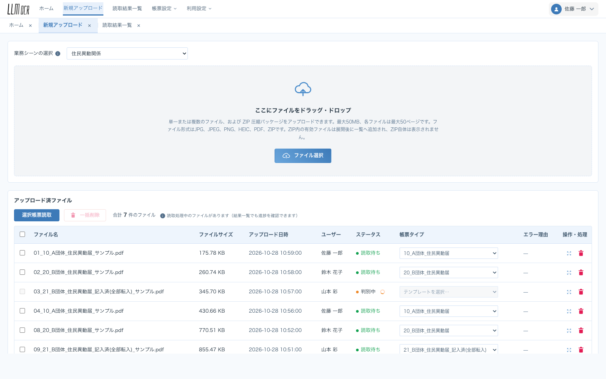

#### 页面与控件

| 区域 | 列／控件 | 规则 |
| --- | --- | --- |
| 上传区 | 業務シーン、拖放区、ファイル選択 | 支持 JPG、JPEG、PNG、HEIC、PDF、ZIP；单文件最大 50MB、最多 50 页 |
| 已上传文件 | 文件名、大小、上传时间、用户、状态、帳票タイプ、错误原因、操作 | 展示当前业务场景下的上传文件 |
| 工具栏 | 選択帳票読取、一括削除 | 按选择结果和权限启用 |
| 帳票タイプ | 下拉框 | 判別中不可编辑；要確認时可选择或修改 |

#### 状态与去向

| 状态 | 触发与去向 |
| --- | --- |
| 判別中 | 系统分类中；类别不可编辑 |
| 要確認 | 等待有权用户选择或确认类别 |
| 読取待ち | 用户点击“選択帳票読取”后进入读取 |
| 失败 | 保留文件并显示错误原因 |

手动上传文件由用户启动读取；自动取入文件自动读取，需确认时停留在本页。读取结果一览的“取込”列显示“自動”或“手動”。

### 5.01 文件一览（F01）

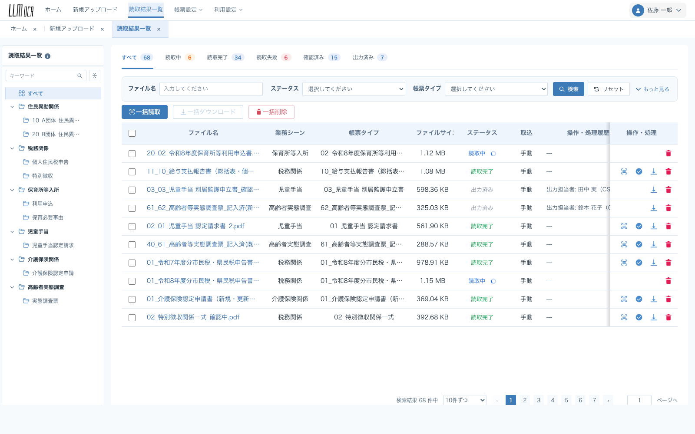

| 项目 | 规则 |
| --- | --- |
| 入口 | 读取结果一览 |
| 数据范围 | 仅显示当前用户有权访问的业务场景、帳票类别和文件 |
| 目录 | 按业务场景／帳票类别展示；名称修改后同步更新 |
| 筛选 | 文件名、状态、类别、业务场景、用户、日期、OCR内容；条件取交集 |
| 状态 | 读取中、读取完成、读取失败、确认完成、已输出 |
| 操作 | 再读取、确认、下载、删除 |

| 页面 | 状态 | 触发与去向 |
| --- | --- | --- |
| 读取结果 | 读取中 | 正在执行 OCR |
| 读取结果 | 读取完成 | OCR 完成，可确认或下载 |
| 读取结果 | 读取失败 | OCR 失败，可再读取 |
| 读取结果 | 确认完成 | 用户完成确认 |
| 读取结果 | 已输出 | 已生成导出文件 |

#### 字段与列表规格

| 区域 | 列／控件 | 规则 |
| --- | --- | --- |
| 文件树 | 业务场景、帳票类别 | 仅显示有权数据；名称修改后同步更新 |
| 默认筛选 | 文件名、状态、帳票类别 | 首屏显示，其余条件折叠 |
| 展开筛选 | 业务场景、创建人、处理人、OCR内容、日期 | 条件取交集；查询范围受权限限制 |
| 文件列表 | 文件名、业务场景、类别、大小、状态、取入方式、历史、创建人、处理人、时间 | 按查询结果分页 |
| 操作列 | 再读取、确认、下载、删除 | 按当前状态和权限启用 |

#### 状态与目录规则

| 状态 | 说明 | 可用操作 |
| --- | --- | --- |
| 读取中 | 正在执行 OCR | 查看进度 |
| 读取完成 | OCR 已完成 | 确认、下载、删除 |
| 读取失败 | OCR 失败 | 再读取、下载、删除 |
| 确认完成 | 用户已确认结果 | 下载、删除 |
| 已输出 | 已生成导出文件 | 下载、删除 |

文件目录按业务场景和帳票类别展示。重命名时同步更新文件树、选择器、筛选项和列表；自动取入使用组织文件夹确定业务场景，物理目录不随类别改名。

### 5.02 自动取入（F02）

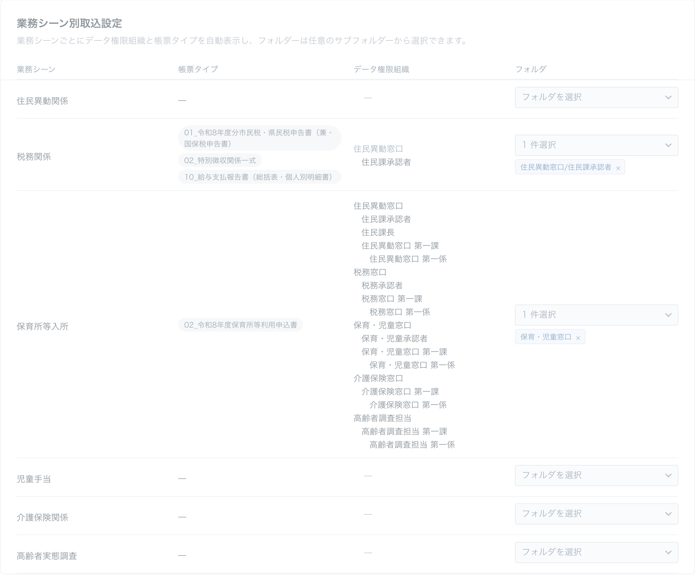

| 项目 | 规则 |
| --- | --- |
| 角色 | 管理员配置；系统扫描和处理；业务用户确认分类 |
| 路径 | 监视根目录、处理后根目录均必填且分别测试 |
| 组织配置 | 一行一个组织，选择组织文件夹和业务场景 |
| 处理流程 | 扫描 → 分类 → 自动读取／人工确认 → 移动源文件 |
| 失败处理 | 按次数重试；保留源文件并记录路径、阶段和原因 |
| 关闭状态 | 路径、组织和执行设置置灰；已有配置保留 |

#### 字段与按钮规格

| 区域 | 字段／按钮 | 必填／状态 | 规则 |
| --- | --- | --- | --- |
| 监视路径 | 路径输入、接続テスト | 必填 | 存在且可读取；修改后须重新测试 |
| 处理后路径 | 路径输入、接続テスト | 必填 | 存在且可写入；不得与监视路径相同或嵌套 |
| 组织配置 | 組織を追加、组织、组织文件夹、业务场景、删除 | 路径测试通过后可选文件夹 | 每行一个组织；文件夹来自测试返回目录树 |
| 执行设置 | 重复排除、判定方法、执行间隔、再执行回数 | 开启时可编辑 | 保存时校验取值范围 |
| 页面开关 | 有効／無効 | 始终可操作 | 无効时配置项置灰并保留原值 |
| 页面按钮 | 閉じる、保存 | 始终可操作 | 保存失败时保留页面输入 |

路径显示使用“¥”，输入兼容反斜杠和“¥”。

~~~text
来源：¥¥filesv01¥取込¥税務課¥住民税¥scan001.pdf
目标：¥¥filesv01¥処理済¥税務課¥住民税¥scan001.pdf
~~~

#### 处理与异常规则

| 阶段 | 条件 | 系统处理 | 结果 |
| --- | --- | --- | --- |
| 扫描 | 文件写入完成 | 递归扫描组织文件夹及子目录 | 创建自动取入任务 |
| 分类 | 命中组织和业务场景 | 在场景关联类别内分类 | 自动读取或等待确认 |
| 分类确认 | 需要人工确认 | 仅向有菜单、组织和场景权限的用户展示 | 确认后启动 OCR |
| 读取成功 | OCR 完成 | 移动源文件并保留相对路径 | 进入读取结果一览 |
| 分类／读取失败 | 失败或无配置 | 保留源文件，记录阶段、路径和原因 | 按设置重试 |
| 移动失败 | OCR 已完成但移动失败 | 保留结果并重试移动 | 源文件不删除 |

| 设置 | 候选／规则 |
| --- | --- |
| 去重范围 | 组织＋实际帳票类别 |
| 文件名判定 | 文件名、大小、修改时间均相同 |
| 内容判定 | SHA-256 相同；改名不影响判定 |
| 归档重名 | 主文件名追加序号，保留扩展名 |

### 5.03 导出设置与下载（F03）

| 项目 | 规则 |
| --- | --- |
| 配置入口 | 帳票类别设置 → 导出设置 |
| 支持格式 | CSV、JSON、PDF |
| CSV | 按帳票类别合并；表格字段按最大列数横向展开 |
| 多类别导出 | 各类别分别生成文件，最终打包为 ZIP |
| 命名 | 单文件沿用原文件名；合并文件使用类别配置名称 |
| 编码 | UTF-8（含 BOM）、UTF-8（省略 BOM）、Shift_JIS |

#### 配置入口与保存

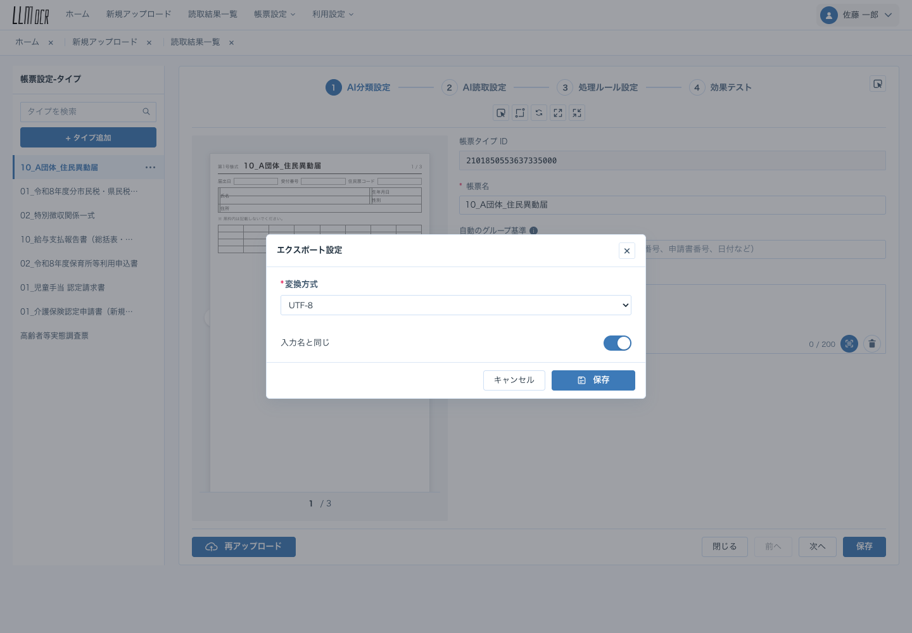

管理员在帳票类别配置中维护导出字段及表格展开规则。导出设置弹窗沿用农林水产产品，依次显示文件名和转换方式，底部为取消、OK。文件名输入框用于配置同类别多个文件合并导出时的名称；单文件默认使用输入文件主名称。文件名旁的注释说明两种情况的命名规则。点击导出设置后直接显示配置弹窗。点击保存后配置生效，并提示保存成功；取消或关闭弹窗时保留原配置。

导出字段配置包括列名、列顺序及文本／表格字段映射。用户在下载入口选择 CSV、JSON 或 PDF。选择 CSV 时，系统自动按帳票类别合并。

#### CSV 数据组织

CSV 一行对应一个输入文件。文本字段和表格字段横向排列。表格按明细记录的顺序横向展开，每条记录内按配置的字段顺序输出。例如先输出“姓名1、续柄1、生年月日1、个人番号1”，再输出“姓名2、续柄2、生年月日2、个人番号2”，依次排列。

每个表格配置最大展开列数。日语界面文案为“最大列数”，说明放在注释图标中。配置上限为 N 时，固定输出 N 个展开列。实际数据不足 N 列时，剩余列保留并填空值；实际数据超过 N 列时，按原数据先后顺序输出前 N 列。例如配置为 5，实际有 3 列时输出 5 列，后 2 列为空；实际有 8 列时输出前 5 列。

同类别多个文件合并时，按配置的 N 列生成统一表头；各文件数据按该表头对齐，缺少的值填空。

批量导出 CSV 时，系统按类别分组，同类别文件合并为一个 CSV；不同类别分别采用自己的列配置。例：“10_A団体_住民異動届”的 3 个文件合并为一个 CSV，“20_B団体_住民異動届”的 7 个文件合并为另一个 CSV，最终生成 2 个 CSV，并打包为一个 ZIP。同属一个业务场景的不同帳票类别分别生成 CSV。

下载方式取决于最终输出的文件数：一个文件直接下载，多个文件打包为 ZIP。CSV 先按类别合并，再计算输出文件数。

#### CSV 导出示例

以下使用客户提供的世带员表格说明。原表中有 3 条已填写的人员记录，按从上到下的顺序读取。

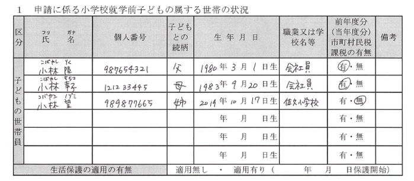

导出时先输出第 1 条记录的全部配置字段，再输出第 2 条记录的全部配置字段，依次展开。原表一行对应一组带相同序号的导出列。

以图中配置的“氏名、続柄、生年月日、個人番号”4 个字段、最大列数 N＝3 为例，生成以下 12 列：

~~~text
第1条：氏名_1 → 続柄_1 → 生年月日_1 → 個人番号_1
第2条：氏名_2 → 続柄_2 → 生年月日_2 → 個人番号_2
第3条：氏名_3 → 続柄_3 → 生年月日_3 → 個人番号_3
~~~

上面三组列依次排列在 CSV 的同一行，实际列名加上表格名称前缀，例如“世帯員テーブル_氏名_1”。字段顺序采用客户的导出配置。

为便于阅读，下面只展示氏名和続柄两个字段的值：

~~~csv
世帯員テーブル_氏名_1,世帯員テーブル_続柄_1,世帯員テーブル_氏名_2,世帯員テーブル_続柄_2,世帯員テーブル_氏名_3,世帯員テーブル_続柄_3
小林 陸,父,小林 早苗,母,小林 望,姉
~~~

N 控制每个配置字段展开的记录数。4 个字段、N＝3 时固定生成 12 个表格字段列：实际只有 2 条记录时，第 3 组的 4 列填空；实际有 4 条记录时，输出前 3 条记录。原表中尚未填写的空白行按空值处理。

同类别有多个输入文件时，每个文件各占 CSV 一行，使用相同表头。业务场景下有多个类别时，分别生成各类别的 CSV，再将多个输出文件打包为 ZIP。

#### JSON 与 PDF

JSON、PDF 的输出内容、数据结构及生成方式沿用农林水产产品。两种格式均按输入文件分别生成输出。本期定制的类别合并、横向展开和固定 N 列规则适用于 CSV。

#### 命名与编码

系统按导出对象自动确定文件名称：

- 单文件导出：默认沿用输入文件主名称，扩展名随导出格式变化。例如“申請001.pdf”导出为 CSV 时，名称为“申請001.csv”；导出为 PDF 时，名称为“申請001.pdf”。
- 同一帳票类别的多个文件合并导出 CSV：使用客户在该帳票类别中配置的导出主名称，扩展名为 .csv。
- 多个帳票类别批量导出：各类别分别按上述规则命名，生成的多个文件打包为 ZIP。

命名区域保留导出名称输入框，供客户配置该类别 CSV 合并导出的文件主名称。配置为空时，以帳票类别名称作为合并导出的文件主名称。ZIP 内存在同名文件时，在文件主名称后追加序号，保留扩展名，确保每个输出文件均被保留。

CSV 编码候选为UTF-8（含 BOM）、UTF-8（省略 BOM）及 Shift_JIS。

原型中的 PDF 为模拟输出；正式功能沿用农林水产产品。Shift_JIS 输出需验证实际编码与兼容性。

### 5.04 登录与用户ID（F04）

| 项目 | 规则 |
| --- | --- |
| 登录标识 | 用户ID＋密码，不使用邮箱 |
| 用户ID | 英文字母和数字，1～10 位；唯一性和大小写规则沿用既有产品 |
| 账号信息 | 姓名、企业名、角色、用户ID、密码修改 |
| 密码修改 | 旧密码、新密码、确认密码均必填；新密码与确认密码必须一致 |
| 退出登录 | 弹窗确认后退出；取消则留在当前页面 |

#### 账号信息与密码修改

右上角头像菜单包含账号信息和退出登录两项。点击账号信息打开独立页面，显示当前用户姓名、企业名、个人角色、用户ID及登录密码编辑入口。

点击登录密码旁的编辑按钮，打开密码修改弹窗。旧密码、新密码和确认密码均为必填项，每个输入框可切换密码显示状态。新密码与确认密码须一致；取消或关闭弹窗时清空本次输入。密码验证和正式修改沿用农林水产产品，原型演示字段校验和保存反馈。

点击退出登录，显示退出确认弹窗。取消时留在当前页面，点击 OK 后执行退出。原型演示确认与反馈，正式会话退出沿用农林水产产品。

### 5.05 部门与用户（F05）

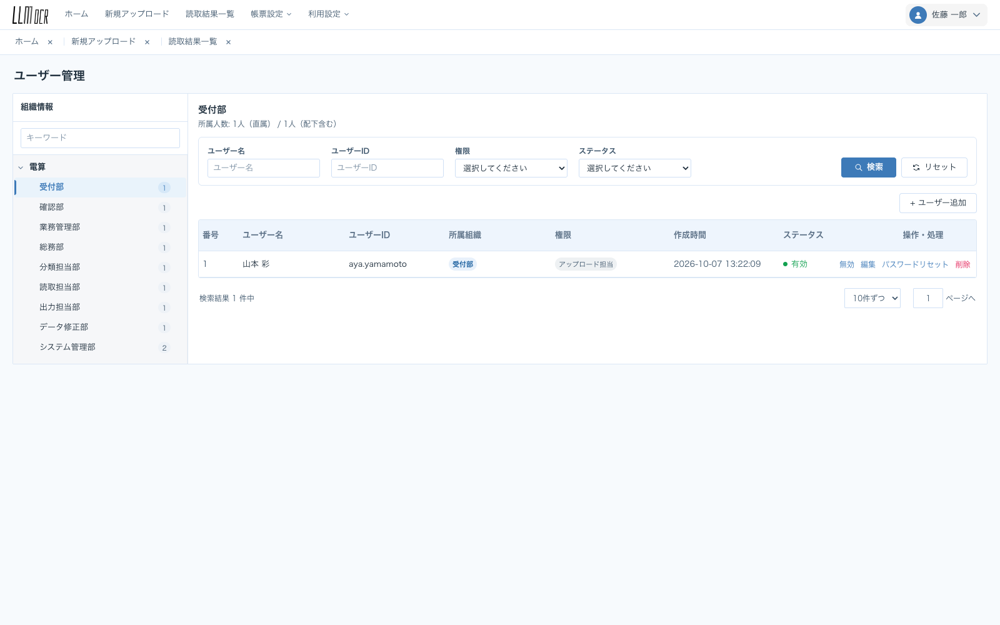

| 项目 | 规则 |
| --- | --- |
| 组织 | 复用组织树；用户仅属于一个直属组织 |
| 用户列表 | 编号、用户名、用户ID、所属组织、权限、创建时间、状态、操作 |
| 用户编辑 | 组织单选，角色在用户处配置 |
| 删除组织 | 弹窗确认；删除范围和保护规则沿用既有产品 |

#### 页面规则

| 场景 | 规则 |
| --- | --- |
| 新增部门 | 上位组织取当前节点；上位组织只读 |
| 编辑部门 | 仅可修改组织名 |
| 删除部门 | 弹窗确认；删除范围和保护规则沿用既有产品 |
| 编辑用户 | 组织单选；角色在用户处配置 |
| 变更组织 | 清除旧成员关系，建立新的唯一关系 |
| 角色变更 | 按剩余角色重新计算菜单权限 |

### 5.06 菜单权限（F06）

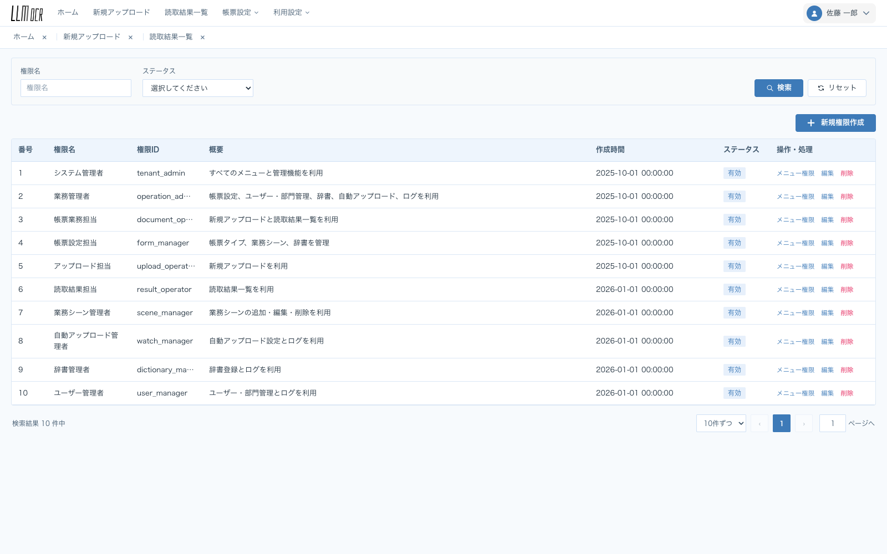

| 项目 | 规则 |
| --- | --- |
| 权限对象 | Home、新规上传、读取结果、帳票设置、利用设置 |
| 操作权限 | 查看、增加、编辑、删除；父项支持全选和部分选中 |
| 场景权限 | 业务场景增加、编辑、删除；文件夹重命名复用编辑权限 |
| 校验 | 菜单入口、页面地址和数据范围均校验角色权限 |

#### 权限规则

| 权限对象 | 操作 |
| --- | --- |
| 菜单 | Home、新规上传、读取结果、帳票设置、利用设置 |
| 业务场景 | 查看、增加、编辑、删除 |
| 用户／部门 | 查看、增加、编辑、删除 |
| 角色 | 查看、增加、编辑、删除 |
| 父级权限 | 支持全选和部分选中 |
| 校验位置 | 菜单入口、页面地址、数据范围 |

### 5.07 业务场景数据授权（F07）

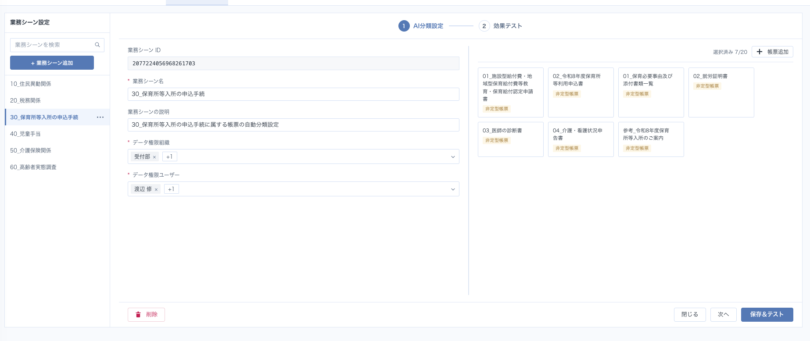

| 项目 | 规则 |
| --- | --- |
| 配置顺序 | 选择组织 → 自动包含组织成员 → 保存 |
| 成员范围 | 所选组织及下级组织的全部成员，自动去重 |
| 保存校验 | 场景名称和授权组织须通过校验 |
| 范围变化 | 缩小组织范围时，同步更新成员范围 |
| 文件联动 | 文件查询和下载必须同时满足租户、场景和菜单权限 |

业务场景数据范围由授权组织及其成员、关联帳票类别共同决定。保存后，文件查询和下载必须同时通过租户、场景和菜单权限校验。

### 5.08 日志（F08）

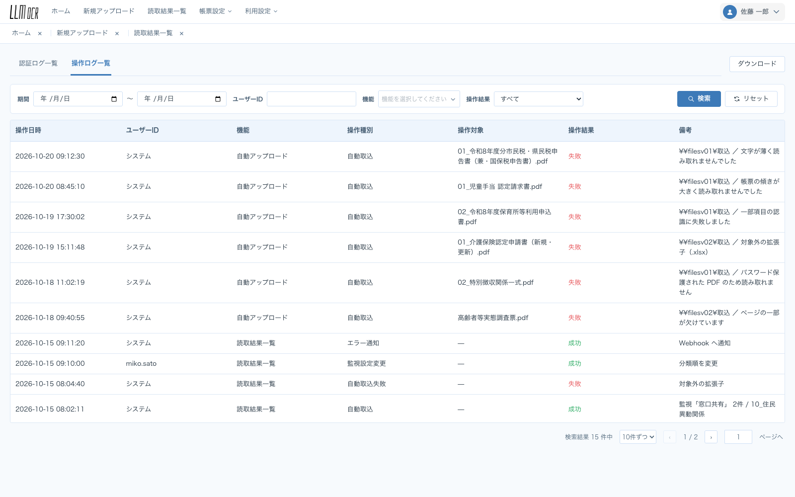

| 类型 | 查询条件 | 列表字段 | 记录范围 |
| --- | --- | --- | --- |
| 认证日志 | 期间、用户ID、事件、结果 | 时间、用户ID、事件、IP、结果、备注 | 登录、登出、密码变更、密码重设 |
| 操作日志 | 期间、用户ID、功能 | 时间、用户ID、功能、操作种类、对象 | 用户业务操作；自动取入和上传文件动作不记录 |

#### 页面结构与检索

页面包含认证日志和操作日志两个 Tab。切换 Tab 后重置该 Tab 的筛选条件和页码。

操作日志功能候选包括新规上传、读取结果一览、帳票类别设置、业务场景设置、辞书注册、用户管理、权限设置、安全设置、日志设置和自动取入设置；支持多选，条件取交集。自动取入和用户上传文件动作不记录，用户手动启动读取记录为“新規アップロード／追加”。

#### 日志导出

检索后按结果分页，改变每页条数时回到第一页。下载当前 Tab 下符合筛选条件的全部记录，导出文件使用用户ID列。

日志保存期限、完整性规则和管理员查询范围沿用农林水产产品。

### 5.09 安全设定（F09）

| 项目 | 规则 |
| --- | --- |
| 复用范围 | 数据保存期限、IP白名单、空闲会话 |
| 校验 | 沿用既有前后端校验规则 |

### 5.10 辞书（F10）

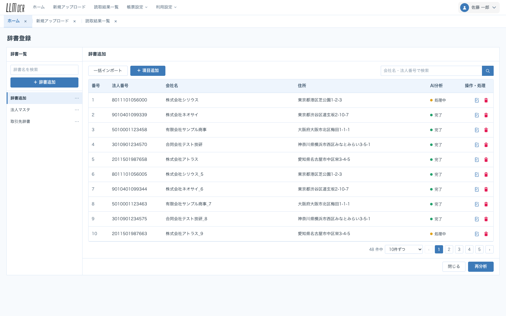

| 项目 | 规则 |
| --- | --- |
| 功能 | 辞书管理、条目维护、导入、向量化 |
| 处理 | 复用共享 GPU 和 Qdrant |
| 隔离 | 按租户隔离辞书数据 |

### 5.11 Home（F11）

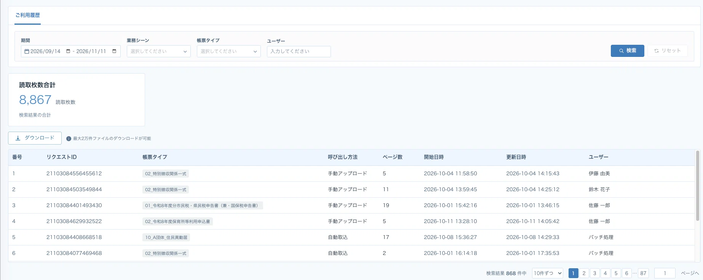

| 项目 | 规则 |
| --- | --- |
| 内容 | 利用履历、计费 |
| 处理 | 沿用既有能力，本期不新增业务规则 |

### 5.12 部署与多租户（F12）

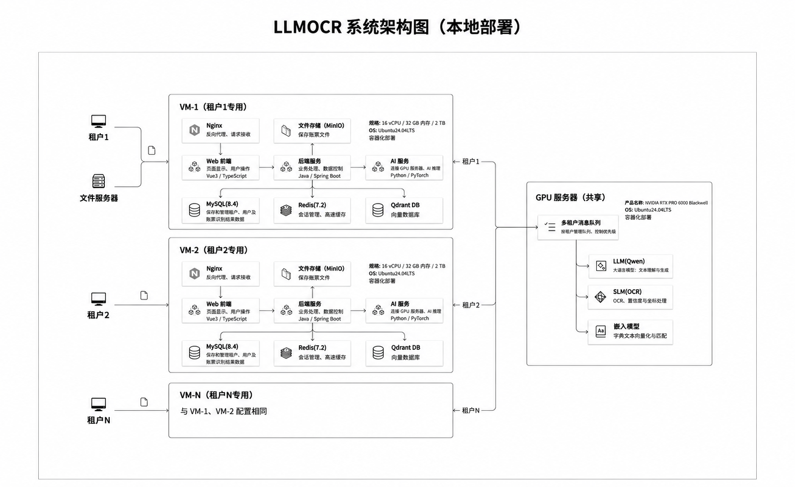

| 项目 | 规则 |
| --- | --- |
| 部署 | 每租户独立 VM、独立登录入口、配置和业务数据 |
| VM | Ubuntu 24.04 LTS；16 vCPU、32 GB 内存、2 TB |
| 服务 | Nginx、前端、后端、AI Service、MySQL、Redis、MinIO |
| 共享资源 | GPU、模型服务、向量库和任务队列 |
| 隔离要求 | 数据库、缓存、文件、队列、GPU结果和向量查询均校验租户标识 |

#### 部署边界

客户架构图为本地私有化部署。每个租户使用一台独立部署的专属 VM，登录入口、配置和业务数据各自独立。每台 VM 配置一个监视根路径，递归扫描组织文件夹及其全部子目录。每条组织配置关联一个物理文件夹和有权使用的业务场景。VM 内部署 Nginx、Vue 3／TypeScript前端、Java／Spring Boot后端、Python／PyTorch AI Service、MySQL 8.4、Redis 7.2及 MinIO。

图示租户 VM 为 16 vCPU、32 GB 内存、2 TB，操作系统为 Ubuntu 24.04 LTS，容器化部署。

租户共享 GPU 服务器，通过多租户消息队列区分租户和调度任务。图中包含 Qwen、自信度评分、坐标抽出、图像倾斜补正、Embedding及 Qdrant。

#### 隔离与共享处理

租户专属 VM 内的数据库、缓存和文件存储分别管理。共享队列、GPU 处理中间数据和向量库按租户标识存取、校验数据。

多租户任务通过共享队列进行调度与优先度控制。GPU、模型服务和向量库在写入、查询、结果回传及删除时均校验租户。
