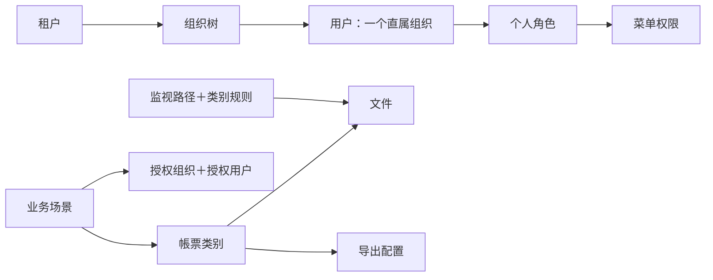

# 电算 LLMOCR 私有化部署项目本期产品需求文档

## 第 1 章｜文档基础与范围

### 1.1 背景与目标

本项目在客户环境内交付 LLMOCR，复用既有产品的帳票配置、识别、组织、用户及权限能力。本期围绕文件一览、自动上传、导出设置和用户ID登录进行定制及适配，并按客户提供的架构部署租户专属应用与共享 GPU 服务。

本期需求以客户确认的 Level 0 必须项及本会话最新决定为准。

### 1.2 本期交付范围

| 模块 | 交付性质 | 本期范围 |
| --- | --- | --- |
| 文件一览 | 定制 | 业务场景／帳票类别目录、文件夹权限联动、目录显示名调整、筛选、排序与批量导出 |
| 自动上传 | 全新定制 | 监视路径、类别子文件夹、自动发现与上传、处理后文件方式、去重、失败重试、操作日志 |
| 帳票类别 | 局部定制 | 仅定制导出配置与执行规则；类别配置、OCR抽出等复用 |
| 业务场景 | 复用 | 选择部门与用户的数据授权、场景关联类别、类别访问控制 |
| 权限管理 | 复用与适配 | 复用角色与菜单授权，调整为本项目菜单及管理子项 |
| 部门与用户 | 复用与适配 | 复用组织层级、用户管理和个人角色分配；用户单一组织归属 |
| 登录 | 适配 | 用户ID＋密码登录，替换邮箱登录 |
| 安全设定 | 复用与裁减 | 复用既有功能，移除 MFA 认证功能 |
| 辞书 | 复用 | 沿用既有辞书与向量化能力 |
| 日志 | 局部适配 | 复用认证／操作日志，增加自动上传记录；查询标识使用用户ID |
| Home | 复用 | 沿用现有利用履历与计费能力 |
| 部署与架构 | 技术实施 | 每租户专属 VM、数据隔离、共享 GPU、多租户任务队列 |

自动上传结果通过操作日志查询。权限配置沿用既有菜单授权。截图用于说明页面结构。

### 1.3 上下游依赖与交付顺序

上游输入包括客户需求清单、系统架构图、既有产品的组织与权限实现，以及导出格式样例。下游包括识别结果使用者及接收导出文件的业务系统。

实施依赖依次为：确认部署资源与目录访问方式 → 接入既有用户、部门和权限能力 → 定制文件一览与导出 → 实现自动上传 → 集成与隔离验证。交付日期由项目计划确定。

既有功能通过现有产品接口接入。

## 第 2 章｜术语与词汇表

| 中文 | 日语／界面 | 定义 |
| --- | --- | --- |
| 租户 | テナント | 拥有独立应用环境、账号和业务数据的使用主体 |
| 组织／部门 | 組織情報／部門 | 用户所属的组织树节点，角色在用户个人处配置 |
| 用户ID | ユーザーID | 用户登录和身份检索使用的账号标识 |
| 用户名 | ユーザー名 | 用户的显示姓名，与用户ID分列展示 |
| 角色 | 権限／ロール | 一组菜单及既有管理子项的授权集合，由用户个人持有 |
| 菜单权限 | メニュー権限 | 允许用户访问的页面及既有管理子项 |
| 业务场景 | 業務シーン | 关联帳票类别及部门、用户数据授权的业务配置 |
| 帳票类别 | 帳票タイプ | 定义帳票识别及输出配置的对象；正文统一使用此名称 |
| 文件夹 | フォルダ | 文件一览中承载场景或类别的目录节点，与服务器物理路径分别管理 |
| 监视路径 | 監視パス | 自动上传服务扫描的物理目录根路径 |
| 类别文件夹 | フォルダ名 | 监视路径下对应帳票类别的子文件夹名称 |
| 处理后路径 | 処理後のファイルパス | 选择移动方式时，接收处理后源文件的目标目录 |
| 认证日志 | 認証ログ一覧 | 登录、登出及密码相关事件的记录 |
| 操作日志 | 操作ログ一覧 | 按本项目功能菜单分类的操作和自动上传处理记录 |

## 第 3 章｜数据结构与状态

### 3.1 实体与关系

- 租户拥有各自的用户、组织、业务场景、类别配置、文件、处理任务和日志。
- 组织构成树形结构。每个用户只属于一个直属组织；上级组织查看范围可包含下级用户，成员关系始终记录直属组织。
- 用户可持有多个角色，角色授予菜单权限。菜单权限根据用户持有的角色计算。
- 业务场景关联帳票类别，并保存授权组织和授权用户。用户候选来自所选组织及其下级；最终数据范围以场景中明确选择的用户为准。
- 文件属于租户和帳票类别。文件一览根据类别关联的场景解析其访问范围。
- 监视配置包含多条监视路径。每条路径保存处理方式、处理后路径及启停状态；类别规则保存类别、子文件夹名及自动取入开关。
- 导出配置属于帳票类别。配置包括输出列、列顺序、文本与表格字段映射、表格展开上限，以及编码和文件命名设置。

### 3.2 文件与任务状态

文件一览沿用原型的读取中、读取完成、读取失败、确认完成、已输出状态。状态改变由识别、确认和导出处理结果触发。

自动上传需区分发现文件、等待处理、处理中、成功、失败和重试过程。具体后端状态码复用既有任务模型，队列和重试状态名称由接口设计确定。

文件访问同时校验菜单授权与数据授权。任务处理结果和失败日志分别保存。日志的成功／失败与文件的识别状态分别记录。

## 第 4 章｜用户交互流程

### 4.1 入口与职责

管理员配置组织、用户、角色、业务场景授权、导出及自动上传。业务用户在获准访问的菜单内查看和处理场景数据。系统服务执行目录扫描、读取、重试及日志记录。

### 4.2 配置场景数据范围

角色：管理员。
目标：指定业务场景的数据访问人员。
流程：业务场景设置 → 选择部门 → 选择用户 → 保存。

1. 管理员选择组织树中的部门。
2. 系统列出这些部门及下级部门的用户候选。
3. 管理员选择具体用户并保存。场景内关联类别复用现有访问控制。
4. 文件一览据此显示获准访问的文件夹和文件。
5. 部门选择改变后，系统清除候选范围外的用户。

### 4.3 自动上传与后续处理

角色：管理员、自动上传服务。
目标：按物理目录自动接收帳票。
流程：配置监视路径与类别目录 → 发现新文件 → 按已配置类别上传并识别 → 识别成功 → 按配置处理源文件 → 记录结果。

1. 管理员配置监视路径、处理方式和类别子文件夹。
2. 系统按目录规则关联租户和已指定的帳票类别。
3. 系统去重后创建处理任务，上传文件并直接启动该类别的识别。
4. 识别成功后，系统按配置移动、删除或保持源文件；识别失败时源文件保留在原监视目录，并按配置重试；重试次数耗尽后，源文件继续保留在原目录，处理结果按日志开关和记录条件更新操作日志。系统按照设定的执行间隔持续扫描监视目录，并对留在目录中的失败文件再次尝试处理。客户可根据日志修正错误原因，也可手动上传文件。
5. 系统将自动上传相关结果写入操作日志。Home 沿用现有功能。

### 4.4 文件查看与导出

角色：具备相应菜单和场景数据访问权的用户。
目标：定位文件并输出业务数据。
流程：文件一览 → 场景／类别文件夹 → 筛选文件 → 选择格式 → 下载。

1. 用户从可见文件夹或筛选条件定位文件。
2. 用户选择一个或多个文件，选择 CSV、JSON 或 PDF。
3. CSV 按类别分组，同类别多个文件合并为一个输出文件。
4. 多个输出文件统一打包为一个 ZIP；单个输出文件直接下载。
5. JSON、PDF 按输入文件分别生成输出。

### 4.5 用户与日志管理

角色：具备管理菜单权限的人员。
目标：维护账号，查询认证和操作结果。
流程：组织信息 → 用户维护 → 分配个人角色；日志 → 选择 Tab → 筛选 → 查看／下载。

1. 用户创建或编辑时选择一个所属组织，并配置个人角色。
2. 用户通过用户ID和密码登录。
3. 管理员分别查询认证日志与操作日志，按用户ID定位记录。
4. 自动上传失败在操作日志中按功能和结果查询。

## 第 5 章｜全量功能清单

| 编号 | 功能名 | 一句话 | 菜单／路由 | 配置／执行 | 本期详写 | 原型状态 |
| --- | --- | --- | --- | --- | --- | --- |
| F01 | 文件一览 | 场景／类别文件夹、查询及数据范围联动 | 读取结果一览／result | 执行 | 是，定制 | 有交互 mock |
| F02 | 自动上传 | 目录发现、处理、重试及源文件处置 | 自动上传／watch | 配置＋执行 | 是，全新 | 目录配置交互 mock |
| F03 | 导出设置与下载 | 按类别配置并输出业务数据 | 帳票类别／ticketDetail；文件一览 | 配置＋执行 | 是，定制 | 部分格式为模拟输出 |
| F04 | 登录与用户ID | 用户ID替换邮箱作为登录标识 | 登录；用户管理／users | 配置＋执行 | 是，适配 | 用户字段交互 mock |
| F05 | 部门与用户 | 单一组织归属及个人角色管理 | 用户管理／users | 配置 | 仅复用边界 | 有交互 mock |
| F06 | 菜单权限 | 复用角色授权并调整项目菜单 | 权限设置／roles | 配置 | 仅菜单适配 | 菜单树 mock |
| F07 | 场景数据权限 | 部门与用户控制场景内类别 | 业务场景／bizScenes | 配置 | 仅复用边界 | 场景选择及文件树联动 mock |
| F08 | 日志 | 认证／操作日志及自动上传记录 | 日志／logs | 执行 | 自动上传增量与字段适配 | Tab、查询、分页、下载 mock |
| F09 | 安全设定 | 沿用既有安全设置并移除 MFA | 安全设置／security | 配置 | 仅裁减边界 | 原型展示复用安全设置 |
| F10 | 辞书 | 复用辞书和向量化 | 辞书／dictionary | 配置＋执行 | 否 | 复用展示 mock |
| F11 | Home | 沿用既有利用履历与计费能力 | Home／home | 执行 | 否 | 复用现有能力 |
| F12 | 部署与多租户 | 租户专属应用与存储、共享 GPU | 部署环境 | 技术实施 | 是，技术边界 | 以架构图说明 |

原型中的数据条数、日期、用户和处理时间用于演示，验收参数按需求确认。

## 第 6 章｜功能详细说明

### 页面总览

文件一览负责目录导航、文件查询与下载。自动上传页负责配置。帳票类别页仅导出部分定制。组织、用户、角色及业务场景页复用既有产品。日志页使用两个 Tab。安全设定和辞书复用，Home 沿用现有能力。

### 6.01 文件一览（F01）

#### 范围与入口

入口为读取结果一览。左侧按业务场景、帳票类别展示文件夹，右侧显示文件列表。文件夹及其文件的数据访问范围跟随业务场景授权。

文件树只显示当前用户获准访问的场景及类别，并展示包含可见类别的场景节点。列表、状态数量、查询结果和下载对象采用相同数据范围。按文件ID请求数据时，服务端同样校验该文件的访问范围。

#### 目录与重命名

系统按业务场景及类别生成目录。目录调整支持重命名。重命名入口及提交检查均跟随业务场景菜单权限。

重命名场景文件夹时，更新对应业务场景名称；重命名类别文件夹时，更新对应帳票类别名称。文件树、业务场景与类别管理页面、选择器、筛选项及文件列表中的名称引用同步更新。从业务场景或类别管理页面修改名称时，文件树同步显示新名称。关联关系通过对象ID保持。

自动上传的物理文件夹名独立维护。新增类别规则时文件夹名留空，由客户填写；保存有效文件夹名后，该类别才参与自动上传识别。后续类别改名时，文件夹名保留原值。

#### 筛选与列表

默认第一行显示文件名、状态、帳票类别，其他条件折叠。展开后包含业务场景、创建人、处理人、读取内容和创建／处理日期。不同条件组合取交集。

状态候选为读取中、读取完成、读取失败、确认完成、已输出。文件名与OCR抽出内容分别检索；读取内容检索需覆盖已保存的修改值。检索作用于全部有权访问的数据，分页作用于检索结果。

列表展示文件名、业务场景、类别、文件大小、状态、取入方式、操作／处理历史、创建人、处理人、创建时间、处理时间及操作。

操作列顺序为再读取、确认、下载、删除。识别、确认及保存规则复用既有能力。文件名可进入结果详情，能否修改由既有业务状态规则决定。

### 6.02 自动上传（F02）

#### 范围说明

自动上传为全新定制。服务运行在客户环境内，通过监视目录发现文件。系统以目录规则中已指定的帳票类别为识别依据，将上传与识别作为连续流程执行。业务场景归属沿用该类别与场景的既有关联。

#### 监视路径字段

| 字段 | 控件 | 必填／默认 | 规则与用途 |
| --- | --- | --- | --- |
| 监视路径 | 路径输入框 | 必填 | 指向租户环境内可读取的目录；一行一条路径 |
| 处理后方式 | 下拉框 | 默认移动 | 候选为移动、删除、保持原样 |
| 处理后文件路径 | 路径输入框 | 移动时必填 | 列始终显示；移动时可编辑，其他方式置灰禁用 |
| 启用 | 开关 | 新增行默认启用 | 关闭后停止该路径的新文件取入 |

处理后路径列固定展示。切回移动时保留此前输入的路径；选择删除或保持原样时，路径字段禁用，系统按对应方式处理源文件。保存时检查目录格式、可访问性及移动目标冲突，实际校验时机与权限由服务端实施。

#### 执行与源文件处理

系统发现文件后，按已配置类别上传并直接启动识别。识别成功后才执行所选的源文件处理方式：移动到处理后路径、删除源文件或保持原样。识别失败时源文件保留在原监视目录，并按配置重试；重试次数耗尽后，源文件继续保留在原目录，处理结果按日志开关和记录条件更新操作日志。系统按照设定的执行间隔持续扫描监视目录，并对留在目录中的失败文件再次尝试处理。客户可根据日志修正错误原因，也可手动上传文件。

#### 帳票类别规则

每个类别一条规则，包含类别、文件夹名及自动取入开关。新增帳票类别时新增对应规则，文件夹名初始为空，由客户填写。客户填写并保存有效文件夹名、开启自动取入后，该类别参与自动上传识别。实际扫描以保存的文件夹名为准。后续类别改名时，文件夹名保留原值。

物理扫描位置为“监视路径＋类别文件夹”。类别文件夹规则用于所有适用的监视路径。同一路径下的有效类别文件夹应唯一对应一个类别。

扩展名匹配及大小写规则由后端统一处理。

#### 去重、重试与日志

提供去重开关、去重方式、重试次数及执行间隔配置。系统按照设定的执行间隔定期扫描监视目录。去重以帳票类别为范围，各类别独立判定。同一文件放入不同类别时分别识别。启用去重时，用户可选择以下两种方式：

- 文件名＋大小＋修改时间：三项均相同时判定为重复文件。
- 内容哈希（SHA-256）：按文件内容的哈希值判断重复。文件名相同且内容有变化的按新文件处理；文件改名后内容相同的判定为重复文件。

记录开关和条件复用当前自动上传配置：开启时按“仅失败／每次”记录相关结果，目标为操作日志。

操作日志至少保留发生时间、系统身份、功能、操作类型、文件／路径、结果与失败原因。用户在操作日志中查询处理结果。

### 6.03 导出设置与下载（F03）

#### 配置入口与保存

管理员在帳票类别配置中维护导出字段及表格展开规则，通过导出设置弹窗维护编码与文件命名。点击导出设置后直接显示配置弹窗。保存生效并提示成功；取消或关闭时保留打开弹窗前的配置。

导出字段配置包括列名、列顺序及文本／表格字段映射。输出格式按需求清单提供 CSV、JSON、PDF。输出格式在下载入口选择，合并按类别规则自动执行。

#### CSV 数据组织

CSV 一行对应一个输入文件。文本字段和表格字段横向排列。表格中同一字段的多个值分别占独立单元格，输出列按序号展开，例如姓名1、姓名2、姓名3。

每个表格配置最大展开列数。日语界面文案为“最大列数”，说明放在注释图标中。实际输出列数取实际展开列数与配置上限中的较小值，按原数据先后顺序输出。例如上限为 5，实际有 3 列时输出 3 列，实际有 8 列时输出前 5 列。

同类别多个文件合并时，按本次文件中实际展开列数的最大值确定统一表头，并受配置上限约束；各文件的数据按该表头对齐。

批量导出 CSV 时，系统按类别分组，同类别文件合并为一个 CSV；不同类别分别采用自己的列配置。例：3 个文件中 2 个属于 A、1 个属于 B，生成 A、B 两个 CSV，并打包为一个 ZIP。

只有一个输出文件时直接下载；多个输出文件打包为一个 ZIP。PDF 按输入文件分别生成，多个输出文件打包。

#### JSON 数据组织

JSON 与 CSV 共用导出字段名称、字段顺序、文本／表格字段映射、横向展开及最大列数规则。CSV 的每一行对应 JSON 数组中的一个对象，代表一个输入文件。对象字段按配置顺序生成，接收系统按字段名称取值。

同类别多个文件合并为一个 JSON 数组；单文件导出同样使用数组结构。合并文件采用统一字段集合，各文件缺少的字段值输出为空字符串。实际输出字段由客户配置确定。多个类别分别生成 JSON，生成多个文件时打包为 ZIP。

#### 命名与编码

系统按导出对象自动确定文件名称：

- 单文件导出：沿用输入文件的主名称，扩展名随导出格式变化。例如“申請001.pdf”导出为 CSV 时，名称为“申請001.csv”；导出为 PDF 时，名称为“申請001.pdf”。
- 同一帳票类别的多个文件合并导出 CSV 或 JSON：使用客户在该帳票类别中配置的导出主名称，扩展名分别为 .csv、.json。
- 多个帳票类别批量导出：各类别分别按上述规则命名，生成的多个文件打包为 ZIP。

命名区域保留导出名称输入框，供客户配置该类别 CSV、JSON 合并导出的文件主名称。单文件命名由系统自动应用。

CSV 编码候选为UTF-8（含 BOM）、UTF-8（省略 BOM）及 Shift_JIS。

原型的 PDF 选项仍存在模拟文本输出，Shift_JIS 需要验证实际编码。PDF 输出沿用既有产品能力，实际输出与编码兼容性在实现时验证。

### 6.04 登录与用户ID（F04）

用户使用用户ID和密码登录。用户ID与显示姓名分开存储和展示。用户ID复用农林水产产品的实现，允许输入英文字母和数字，长度为 1～10 位。大小写处理及唯一性校验沿用农林水产产品。登录标识由邮箱改为用户ID。

用户ID在登录及用户检索中使用；日志以该身份标识关联事件。

本期移除 MFA，其他安全规则复用既有产品。

### 6.05 部门与用户（F05）

#### 复用边界与组织编辑

复用现有产品的组织树和用户管理。左侧标题为组织信息，节点使用部门名称。每个用户仅属于一个直属组织。

从节点菜单新增下级部门时，上位组织取当前节点。新增及编辑窗口中的上位组织标灰并以只读方式展示；编辑只允许修改组织名。

删除组织需显示站内确认弹窗，说明会删除下级组织和本组织、下级组织所属的用户。取消时保留原数据，确认后才执行。组织删除保护规则复用既有产品。

#### 用户页面

列表列顺序为编号、用户名、用户ID、所属组织、权限、创建时间、状态、操作／处理。表头与对应内容左对齐。所属组织仅显示直属组织。

用户编辑中组织为单选，角色在用户处配置。改变组织时清除旧组织成员关系，建立唯一的新关系；场景数据访问按当前授权规则校验。

组织归属与个人角色分别维护。角色移除后，系统按剩余个人角色重新计算菜单访问范围。

### 6.06 菜单权限（F06）

#### 复用与菜单调整

复用既有角色授权窗口，标题为菜单权限。菜单树按 Home、新规上传、读取结果一览、帳票设置和利用设置组织。

用户管理下保留用户照会、增加、编辑、删除，以及部门照会、增加、编辑、删除。权限设置下保留角色照会、增加、编辑、删除。父项支持批量勾选子项及部分选中展示。

具有页面访问权限后使用页面的既有业务交互，状态、数据范围及既有管理约束仍有效。

菜单及地址访问均按角色授权校验。默认角色配置应与复用产品及本项目菜单一致。

### 6.07 业务场景数据授权（F07）

该功能复用既有产品。业务场景内配置授权组织与授权用户，先选组织再选用户。用户候选包含所选组织及下级部门用户，去重显示。

保存前检查场景名称、授权组织和授权用户。减少组织范围时清除候选范围外的已选用户。

场景下类别的访问控制复用现有能力。本项目仅定制文件一览对该数据范围的联动。所有文件查询与下载都必须在租户和场景授权范围内执行。

### 6.08 日志（F08）

#### 页面结构与检索

沿用既有认证、操作日志。页面直接显示认证日志和操作日志两个 Tab。下载在 Tab 行右侧，检索及更新按钮在筛选区右侧。切换 Tab 后重置当前 Tab 专属筛选条件和页码。

认证日志事件为登录、登出、密码变更、密码重设。查询条件包含期间、用户ID、事件及操作结果。列表展示操作时间、用户ID、事件种类、IP地址、结果和备注。

操作日志查询包含期间、用户ID、功能及操作结果。功能候选为新规上传、读取结果一览、帳票类别、业务场景、辞书、用户管理、权限设置、安全设置、日志和自动上传，支持多选；功能之间取并集，功能与用户ID、期间、结果之间取交集。已选功能显示标签，超过可见数量时收起计数。

操作列表展示操作时间、用户ID、功能、操作种类、操作对象、结果和备注。自动上传的系统事件使用系统身份。

#### 自动上传增量与导出

自动上传失败归入操作日志中的自动上传功能，操作对象关联文件或路径，备注保留失败原因。任务结果及源文件处理失败应能定位到同一次处理，后端关联标识需在接口设计中确定。

检索后按结果分页，改变每页条数时回到第一页。下载输出当前 Tab 及全部当前筛选结果。下载文件沿用用户ID列。

保存期限、日志完整性要求和管理员查询范围复用既有产品，超出部分在接口确认时登记。

### 6.09 安全设定（F09）

安全设定复用既有产品，仅移除 MFA。数据保存期限、IP白名单及空闲会话等能力沿用复用版本。实施时核对复用版本，保留其适用安全规则及后端校验。

### 6.10 辞书（F10）

辞书管理、条目维护、导入及向量化全部复用。共享 GPU 和 Qdrant 接入属于部署与租户隔离实施范围。

### 6.11 Home（F11）

Home 沿用现有利用履历与计费内容。

### 6.12 部署与多租户（F12）

#### 部署边界

客户架构图为本地私有化部署。每个租户使用专属 VM，部署 Nginx、Vue 3／TypeScript前端、Java／Spring Boot后端、Python／PyTorch AI Service、MySQL 8.4、Redis 7.2及 MinIO。

图示租户 VM 为 16 vCPU、32 GB 内存、2 TB，操作系统为 Ubuntu 24.04 LTS，容器化部署。

租户共享 GPU 服务器，通过多租户消息队列区分租户和调度任务。图中包含 Qwen、自信度评分、坐标抽出、图像倾斜补正、Embedding及 Qdrant。

#### 隔离与共享处理

租户专属 VM 内的数据库、缓存和文件存储分别管理。共享队列、GPU处理中间数据及向量库也必须携带和校验租户范围。

多租户任务通过共享队列进行调度与优先度控制。GPU、模型及向量库的租户边界需覆盖写入、查询、结果回传和删除。

模型服务应分别列出既有组件与本期改造清单。
