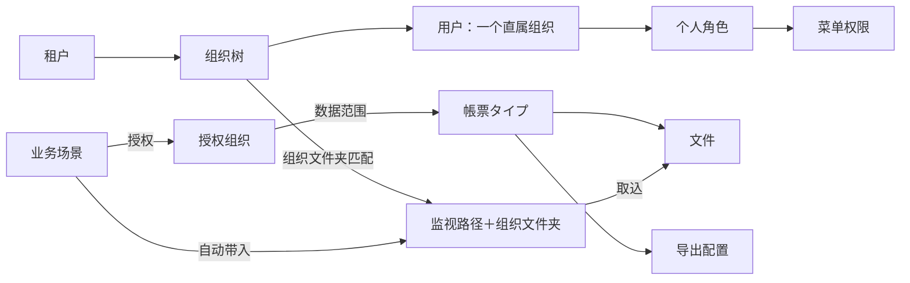
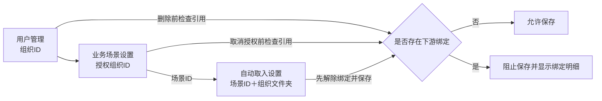
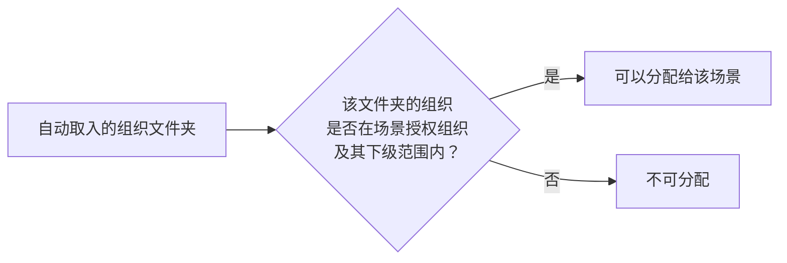

# 电算Phase1产品需求文档V1.0

## 第 1 章｜文档基础与范围

### 1.1 背景与目标

本项目在客户环境内部署 LLMOCR，沿用农林水产产品的帳票配置、识别、组织、用户和权限功能。本期定制文件一览、自动取入和 CSV 导出，并将登录账号改为用户ID。每个租户独立部署应用环境，共用 GPU 识别服务。

### 1.2 本期交付范围

| 模块 | 交付性质 | 本期范围 |
| --- | --- | --- |
| 文件一览 | 定制 | 业务场景／帳票タイプ目录、文件夹权限联动、目录名称调整、筛选、排序与批量导出 |
| 自动取入 | 全新定制 | 监视与处理后路径、组织目录递归扫描、文件名与路径正规化、自动分类与读取、去重、失败重试、错误记录（记录本期保存，仪表盘展示为2期） |
| 帳票タイプ | 局部定制 | 仅定制导出配置与执行规则；类别配置、OCR抽出等复用 |
| 业务场景 | 复用 | 选择组织的数据授权、场景关联类别、类别访问控制 |
| 部门与用户 | 复用与适配 | 复用组织层级、用户管理和个人角色分配；用户单一组织归属 |
| 登录 | 适配 | 用户ID＋密码登录，替换邮箱登录 |
| 日志 | 局部适配 | 复用认证／操作日志，查询标识使用用户ID；系统自动取入事件不进入操作日志 |
| Home | 复用 | 沿用现有利用履历与计费能力 |
| 部署与架构 | 技术实施 | 每租户专属 VM、数据隔离、共享 GPU、多租户任务队列 |

截图用于说明页面布局和操作入口。

## 第 2 章｜数据结构与状态

### 2.1 实体与关系

- 租户拥有各自的用户、组织、业务场景、类别配置、文件、处理任务和日志。
- 组织构成树形结构。每个用户只属于一个直属组织；上级组织查看范围可包含下级用户，成员关系始终记录直属组织。
- 用户可持有多个角色，角色授予菜单权限。菜单权限根据用户持有的角色计算。
- 组织本身不持有权限，也不能在组织节点上修改权限；菜单权限授予到用户（个人角色）。业务画面以画面为单位授权，确认和导出不单独设权限节点；只有设定类画面的部分项目细分追加、編集、削除。业务场景的授权组织只决定数据范围。因此同一组织内不同用户的权限可以不同。
- 业务场景关联帳票タイプ，并保存授权组织。选择组织后，默认包含该组织及下级组织的全部成员。
- 文件属于租户和帳票タイプ。文件一览按类别所属场景的授权范围显示文件。
- 每个租户 VM 配置一条监视路径和一条处理后路径。每条取入配置保存组织ID、组织文件夹相对路径和业务场景；组织文件夹下的目录统一递归扫描。物理目录不与帳票タイプ绑定。
- 导出配置属于帳票タイプ。配置包括输出列、列顺序、文本与表格字段映射、表格展开上限，以及编码和文件命名设置。

帐票类别在业务场景下维护；图中按权限链路绘制：业务场景 → 授权组织 → 帳票タイプ → 文件，授权组织决定该场景内可见和可操作的帳票タイプ与文件。自动取入配置把现有业务场景全部列出，每个场景一行、固定显示，不能增删；保存值为场景ID和组织文件夹相对路径，データ権限組織和帳票タイプ由场景自动带出。

#### 组织、业务场景与自动取入的绑定关系

画面上按现有业务场景逐个显示行，场景不可选择、不可增删。每行填写文件夹后，系统带出该场景的授权组织（含下级）作为データ権限組織；フォルダは客户自行映射，系统不校验所属组织；帳票タイプ取场景绑定的全部类别，只读。未填写文件夹的场景不参与自动取入。

| 页面 | 字段 | 候选来源 | 保存值 | 下游用途 |
| --- | --- | --- | --- | --- |
| 用户管理 | 组织 | 用户管理组织树 | 组织ID | 业务场景授权组织、自动取入组织候选 |
| 业务场景设置 | 数据权限组织 | 用户管理组织树 | 组织ID列表 | 决定场景成员范围、自动取入的データ権限組織和帳票タイプ |
| 自动取入设置 | 业务场景 | 全部业务场景（固定显示，不可增删） | 场景ID | 决定データ権限組織和 AI 分类候选类别 |
| 自动取入设置 | 組織フォルダー | 监视路径下的文件夹（按原层级展开的下拉目录树，可多选，含类别文件夹） | 相对路径列表 | 每个文件夹单独推导组织；共同决定扫描范围 |
| 自动取入设置 | データ権限組織 | 场景授权组织（含下级） | 组织ID（自动推导，只读） | 仅作为场景信息显示，不用于校验文件夹；按组织层级缩进 |
| 自动取入设置 | 帳票タイプ | 场景绑定的全部类别 | 不保存（仅显示） | 画面展示分类范围 |

组织映射的目的不只是确定扫描范围。AI 分类有上下文上限，候选帳票タイプ越多，提示词越长，越容易超出限制或降低判定精度；先确定业务场景后，只在该场景的帳票タイプ内比较，分类范围更窄、精度更高。AI 无法确定类别时，文件以「要確認」停在接收页，按该场景的数据权限判定可见性。判定不使用文件的来源组织；来源组织只影响归属、去重和归档。

#### 自动取入不进行联动校验

自动取入的文件夹映射由客户自行维护。系统不校验文件夹所属组织是否在场景的数据权限组织内，也不在组织/场景变更时自动清理或阻止保存。

- 场景删除、改名、调整数据权限组织或帳票タイプ：不阻止，也不自动清理已有文件夹映射。
- 组织删除、组织改名：不检查自动取入引用，文件夹路径仍按客户配置保留。
- 保存时仅校验：路径格式、文件夹是否重复或上下级重叠、该场景是否有关联帳票タイプ。

## 第 3 章｜用户交互流程

### 3.1 入口与职责

管理员配置组织、用户、角色、业务场景授权、导出及自动取入。业务用户在获准访问的菜单内查看和处理场景数据。系统服务执行目录扫描、读取、重试及日志记录。

### 3.2 配置场景数据范围

角色：管理员。
目标：指定业务场景的数据访问组织及成员范围。

流程：

~~~text
业务场景设置 → 选择组织 → 自动包含组织成员 → 保存
~~~

1. 管理员选择组织树中的部门。
2. 系统自动包含所选组织及下级组织的全部成员。
3. 管理员保存业务场景。场景内关联类别复用现有访问控制。
4. 文件一览据此显示获准访问的文件夹和文件。
5. 组织选择改变后，系统同步更新成员范围。

### 3.3 自动取入与后续处理

角色：管理员、自动取入服务、组织业务用户。
目标：按物理目录自动接收帳票，并由有权用户处理需确认的分类。

流程：

~~~text
配置两条根路径及组织对应关系
→ 分别测试路径并保存
→ 发现新文件
→ 在组织对应的业务场景内分类
→ 自动读取或人工确认分类后读取
→ 移动源文件并记录结果
~~~

1. 管理员配置监视根路径、处理后根路径，分别执行连接测试，再为每个组织选择监视路径下的文件夹及有权使用的业务场景。连接测试未通过时不能保存。
2. 系统在当前租户 VM 的监视路径下递归发现文件，按固定规则判定扩展名、正规化路径，并根据来源的组织文件夹确定组织和业务场景。组织文件夹以下的目录无需逐项配置，也不绑定帳票タイプ。
3. 系统确认文件写入完成后上传，并在所选业务场景关联的帳票タイプ内执行 AI 分类。能确定类别时直接启动 OCR；需确认时，在新规上传页等待具备「新規アップロード」画面权限、且所属组织在场景授权组织（含下级）范围内的用户确认或修改类别（候选类别限定在该业务场景内），再继续读取。
4. 读取结果一览的“取込”列把这批文件显示为“自動”，用户手动上传并读取的文件显示为“手動”。新规上传页不显示取入方式列。
5. 识别成功后，系统将源文件移动到处理后路径，保留来源的相对目录层级。失败时保留源文件，按设定重试并记录错误；后续扫描按执行间隔再次处理。

### 3.4 文件查看与导出

角色：具备相应菜单和场景数据访问权的用户。
目标：定位文件并输出业务数据。

流程：

~~~text
文件一览 → 场景／类别文件夹 → 筛选文件 → 选择格式 → 下载
~~~

1. 用户从可见文件夹或筛选条件定位文件。
2. 用户选择一个或多个文件，选择 CSV、JSON 或 PDF。
3. CSV 按类别分组，同类别多个文件合并为一个输出文件。
4. 多个输出文件统一打包为一个 ZIP；单个输出文件直接下载。
5. JSON、PDF 按输入文件分别生成输出。

### 3.5 配置帳票タイプ导出

角色：具备帳票タイプ配置权限的管理员。
目标：设置类别的导出字段、合并文件名与 CSV 编码。

流程：

~~~text
帳票タイプ设置 → 导出设置 → 保存配置 → 文件一览选择文件并导出
~~~

1. 管理员在帳票タイプ中配置输出列及表格字段展开上限，并在导出设置弹窗填写合并导出时使用的文件名和转换方式。
2. 用户导出单个文件时，输出文件默认沿用输入文件主名称，并使用目标格式的扩展名。
3. 用户导出同一类别的多个文件为 CSV 时，系统合并为一个 CSV，使用该类别配置的文件名；不同类别分别输出。
4. 系统根据最终输出文件数直接下载或打包 ZIP。

### 3.6 用户与日志管理

1. 用户创建或编辑时选择一个所属组织，并配置个人角色。
2. 用户通过用户ID和密码登录。
3. 管理员分别查询认证日志与操作日志，按用户ID定位记录。
4. 自动取入失败时，系统记录文件、来源路径、失败阶段和原因。

## 第 4 章｜功能详细说明

原型中的数据条数、日期、用户和处理时间用于演示，验收参数按需求确认。

### 页面总览

| 模块 | 入口 | 主要职责 | 类型 |
| --- | --- | --- | --- |
| 文件一览 | 读取结果一览 | 查询、确认、下载、删除 | 定制 |
| 自动取入 | 自動取込設定 | 监视路径、自动分类、读取、重试 | 全新 |
| 导出 | 帳票タイプ／文件一览 | 配置字段并导出 CSV、JSON、PDF | 定制 |
| 用户 | 用户管理 | 维护组织、用户和个人角色 | 复用适配 |
| 业务场景 | 业务场景设置 | 配置组织、用户和类别数据范围 | 复用适配 |
| 日志 | 日志 | 查询认证日志和操作日志 | 适配 |
| 其他 | Home | 沿用既有能力 | 复用 |

### 4.00 新规上传页面

#### 页面与控件

| 区域 | 列／控件 | 规则 |
| --- | --- | --- |
| 上传区 | 業務シーン、拖放区、ファイル選択 | 支持 JPG、JPEG、PNG、HEIC、PDF、ZIP；单文件最大 50MB、最多 50 页 |
| 已上传文件 | 文件名、大小、上传时间、用户、状态、帳票タイプ、错误原因、操作 | 展示当前业务场景下的上传文件 |
| 工具栏 | 選択帳票読取、一括削除 | 按选择结果和权限启用 |
| 帳票タイプ | 下拉框 | 判別中不可编辑；要確認时可选择或修改 |

#### 状态与去向

| 状态 | 触发与去向 |
| --- | --- |
| 判別中 | 系统分类中；类别不可编辑 |
| 要確認 | 等待具备「新規アップロード」画面权限、且所属组织在场景授权组织（含下级）范围内的用户选择或确认类别；候选类别为该文件所属业务场景内的帳票タイプ |
| 読取待ち | 用户点击“選択帳票読取”后进入读取 |
| 失败 | 保留文件并显示错误原因 |

手动上传文件由用户启动读取；自动取入文件自动读取，需确认时停留在本页。读取结果一览的“取込”列显示“自動”或“手動”。

自动取入文件由组织映射确定业务场景。分类结果不确定时，只有同时满足「所属组织在该场景授权组织（含下级）范围内」并具备「新規アップロード」画面权限的用户可见并确认；其他用户既看不到文件，也不会出现在候选类别中。文件的来源组织只决定归属、去重范围和归档路径，不参与权限判定。

### 4.01 文件一览

| 项目 | 规则 |
| --- | --- |
| 入口 | 读取结果一览 |
| 数据范围 | 仅显示当前用户有权访问的业务场景、帳票タイプ和文件（所属组织在场景授权组织含下级内＋「読取結果一覧」菜单权限） |
| 目录 | 按业务场景／帳票タイプ展示；名称修改后同步更新 |
| 筛选 | 文件名、状态、类别、业务场景、用户、日期、OCR内容；条件取交集 |
| 状态 | 读取中、读取完成、读取失败、确认完成、已输出 |
| 操作 | 再读取、确认、下载、删除 |

| 页面 | 状态 | 触发与去向 |
| --- | --- | --- |
| 读取结果 | 读取中 | 正在执行 OCR |
| 读取结果 | 读取完成 | OCR 完成，进入确认流程 |
| 读取结果 | 读取失败 | OCR 失败，保留失败状态 |
| 读取结果 | 确认完成 | 用户完成确认，进入输出流程 |
| 读取结果 | 已输出 | 文件已完成输出 |

#### 字段与列表规格

| 区域 | 列／控件 | 规则 |
| --- | --- | --- |
| 文件树 | 业务场景、帳票タイプ | 仅显示有权数据；名称修改后同步更新 |
| 默认筛选 | 文件名、状态、帳票タイプ | 首屏显示，其余条件折叠 |
| 展开筛选 | 业务场景、创建人、处理人、OCR内容、日期 | 条件取交集；查询范围受权限限制 |
| 文件列表 | 文件名、业务场景、类别、大小、状态、取入方式、历史、创建人、处理人、时间 | 按查询结果分页 |
| 操作列 | 再读取、确认、下载、删除 | 按当前状态和权限启用 |

#### 文件树与名称、权限的联动

| 项目 | 规则 |
| --- | --- |
| 结构 | 第 1 层业务场景、第 2 层帳票タイプ、第 3 层文件；层级固定，同层只能排序 |
| 名称来源 | 文件夹名直接使用业务场景／帳票タイプ的名称，不在文件树里另存显示名；文件节点显示文件名 |
| 改名联动 | 在设定画面或文件树改名，都直接修改该业务场景／帳票タイプ的名称：文件树、筛选下拉、上传画面的帳票タイプ候选、导出默认命名、权限设置等同步更新 |
| 名称一致 | 业务场景名、帳票タイプ名与文件树文件夹名始终一致；树上改名等同于重命名，名称不能为空 |
| 同名禁止 | 业务场景在同一租户内唯一，帳票タイプ在同一租户内全场景唯一（跨业务场景也不能重名）；新建和改名都校验，重名时提示并保留原名称（`同じ名前は使用できません`） |
| 权限与显示 | 只显示用户数据权限内的场景／类别分支（所属组织在场景授权组织含下级＋菜单权限）；无权限的分支不显示，不置灰 |
| 权限与改名 | 改名按设定画面的菜单权限判定；改名不改变场景／类别ID，已有权限和自动取入配置不受影响 |

#### 状态规则

| 状态 | 含义 | 后续状态 |
| --- | --- | --- |
| 读取中 | 系统正在执行 OCR | 读取完成／读取失败 |
| 读取完成 | OCR 已完成，等待确认 | 确认完成 |
| 读取失败 | OCR 未完成 | 读取中／保持失败 |
| 确认完成 | 用户已完成确认 | 已输出 |
| 已输出 | 已生成输出文件 | 保持已输出 |

### 4.02 自动取入

| 项目 | 规则 |
| --- | --- |
| 角色 | 管理员配置；系统扫描和处理；业务用户确认分类 |
| 路径 | 监视根目录、处理后根目录均必填且分别测试；测试未通过不可保存 |
| 组织配置 | 一行一个业务场景，全部固定显示、不可增删；同一场景可设置多个文件夹；填写文件夹才参与取入；データ権限組織和帳票タイプ自动带出，只读；区域随内容向下延展，不横向拖动 |
| 处理流程 | 扫描 → 分类 → 自动读取／人工确认 → 移动源文件 |
| 失败处理 | 按次数重试；保留源文件并记录路径、阶段和原因 |
| 取入対象 | 仅 PDF、TIFF、JPEG、PNG；扩展名、路径和文件名按固定规则正规化后判定 |
| 关闭状态 | 路径、文件夹和执行设置置灰；已有配置保留 |

#### 字段与按钮规格

| 区域 | 字段／按钮 | 必填／状态 | 规则 |
| --- | --- | --- | --- |
| 监视路径 | 路径输入、接続テスト | 必填 | 存在且可读取；测试期间显示目录读取中间态；修改后须重新测试；未通过时保存被阻止 |
| 处理后路径 | 路径输入、接続テスト | 必填 | 存在且可写入；不得与监视路径相同或嵌套；修改后须重新测试 |
| 组织配置 | 業務シーン（只读固定）、帳票タイプ（只读）、データ権限組織（只读、按组织层级缩进）、フォルダ（按原文件夹层级展开的下拉目录树，可多选） | 路径测试通过后可选择并保存 | 前三列均不可选择；同一场景可选择多个文件夹，文件夹由客户自行映射，系统不校验所属组织；下拉目录树按原文件夹层级缩进、可展开/收起；同一场景内不能重复或父子重叠；跨场景不能选完全相同的文件夹，但允许父目录/子目录分别映射到不同场景；已使用/重叠的选项在下拉中置灰，前端直接阻止选择；保存时再做一次校验；用标签展示已选文件夹，可逐个删除；区域随内容向下延展，不横向拖动 |
| 执行设置 | 重复排除、判定方法、执行间隔、再执行回数 | 开启时可编辑 | 执行间隔 1～9999；再执行回数 0～10；保存时校验取值范围 |
| 页面开关 | 有効／無効 | 始终可操作 | 无効时配置项置灰并保留原值 |
| 页面按钮 | 閉じる、保存 | 始终可操作 | 保存失败时保留页面输入 |

路径保存、比较和画面显示使用半角反斜杠 `\`；输入兼容半角 `¥` 和全角 `￥`（以及 `/`），保存时统一为 `\`。`￥` 在 Windows 中不是有效分隔符，仅作为输入兼容处理。

~~~text
来源：\\filesv01\取込\税務課\住民税\scan001.pdf
目标：\\filesv01\処理済\税務課\住民税\scan001.pdf
~~~

#### 连接测试与失败校验

连接测试（接続テスト）由服务器访问共享文件夹。监视路径测试还会读取文件夹目录，因此不立即返回结果。测试结果只对当前路径有效，路径被修改后须重新测试。

| 对象 | 条件 | 显示与处理 | 日语文案 |
| --- | --- | --- | --- |
| 监视路径 | 未输入 | 显示错误；不显示「有効」；不能保存 | `パスを確認してください` |
| 监视路径 | 已发起测试，服务器尚未返回目录 | 路径输入和测试按钮不可操作；显示「フォルダーを取得中…」；保留原有配置；不能保存 | `フォルダーを取得中…` |
| 监视路径 | 无法连接或不可读取 | 同上；提示检查路径和访问权限 | `パスを確認してください` |
| 监视路径 | 可连接、可读取且目录返回成功 | 使用返回目录刷新文件夹候选；显示「有効」；组织文件夹可选择 | `フォルダーの取得が完了しました` |
| 监视路径 | 连接或目录读取失败 | 退出读取中间态；不替换目录候选；保留原有配置；可重新测试 | `パスを確認してください` |
| 处理后路径 | 未输入、不可写入，或与监视路径相同／嵌套 | 显示错误；不显示「有効」；不能保存 | `パスを確認してください` |
| 处理后路径 | 可连接且可写入 | 显示「有効」 | `接続確認が完了しました` |
| 路径修改后 | 已通过测试的路径被编辑 | 清除「有効」；提示「監視パスを先に接続テスト」；已输入文件夹保留，但保存被阻止 | — |
| 保存（有効时） | 任一路径未测试或测试未通过 | 不保存，提示先执行接続テスト；保留页面输入 | `監視パスと処理後パスの接続テストを実行してください` |

#### 保存时的校验

连接测试以外的输入值在保存时按以下顺序校验。命中第一个错误时显示对应消息并整体不保存，全部通过才保存。自动取入为无効时不做校验，直接保存当前输入。

| 顺序 | 对象 | 条件 | 日语文案 |
| --- | --- | --- | --- |
| 1 | 监视路径 | 未输入 | `監視フォルダーを入力してください` |
| 2 | 处理后路径 | 未输入 | `処理後フォルダーを入力してください` |
| 3 | 路径关系 | 相同，或一方位于另一方之下 | `監視フォルダーと処理後フォルダーは別の階層に設定してください` |
| 4 | 业务场景 | 没有任何填写了文件夹的场景行 | `有効な業務シーンを設定してください` |
| 6 | 组织文件夹 | 未输入、为 `.`／`..`，或名称含反斜杠、斜杠、`¥`、冒号、星号、问号、双引号、尖括号、竖线 | `組織フォルダーを確認してください` |
| 7 | 组织文件夹 | 与其他场景的文件夹完全相同，或同一场景内为上级／下级；下拉中置灰并由前端阻止选择 | `組織フォルダーが重複しています` |
| 8 | 帳票タイプ | 场景没有绑定任何帳票タイプ | `この業務シーンの帳票タイプがありません` |
| 9 | 业务场景 | 场景授权组织（含下级）内，没有具备「新規アップロード」菜单权限的用户 | `この業務シーンのデータ権限範囲に「新規アップロード」の権限を持つユーザーがいません。権限を設定してから保存してください` |

#### 组织映射与人工确认

组织映射（业务场景 → データ権限組織 → 组织文件夹）除了确定扫描范围，还决定 AI 分类的候选范围和人工确认的范围。创建配置时业务场景固定显示，文件夹由客户自行映射。

| 环节 | 规则 | 结果 |
| --- | --- | --- |
| 文件发现 | 按组织文件夹路径匹配组织 | 未配置组织文件夹的目录不取入 |
| AI 分类 | 只在该场景的帳票タイプ内分类；候选类别少，缩短 AI 上下文 | 能确定类别时直接读取 |
| 分类确认权限 | 场景数据权限（授权组织含下级）＋用户菜单权限 | 分类未定时也能判定 |
| 人工确认 | 具备「新規アップロード」画面权限且所属组织在场景授权组织（含下级）内的用户可见 | 其他用户看不到该文件 |
| 候选类别 | 帳票タイプ下拉只显示该业务场景内的类别 | 用户选择或修改后启动 OCR |

场景授权组织向下包含下级组织，不向上包含；该层级用于画面显示，自动取入的文件夹映射不在此校验。

用两个具体场景举例：**住民異動関係** 的授权组织是「総務部」，**税務関係** 的授权组织是「第一課」。

| 自动取入的文件夹（组织） | 住民異動関係（授权：総務部） | 税務関係（授权：第一課） |
| --- | --- | --- |
| 総務部 | 可选（授权组织自身） | 不可选（在授权组织第一課的上级） |
| 第一課 | 可选（在総務部之下） | 可选（授权组织自身） |
| 第一係 | 可选（在総務部之下） | 可选（在第一課之下） |
| 受付部 | 不可选（不在授权范围内） | 不可选（不在授权范围内） |

例：把「第一課」文件夹分配给「税務関係」可以；分配给「住民異動関係」也可以；「受付部」两个场景都不行。

判定：文件夹的组织必须落在场景授权组织的子树内（含自身）。场景授权组织是文件夹组织的祖先或自身时可选；文件夹在场景授权组织的上级时不可选。

AI 分类有上下文上限，把所有帳票タイプ都放入提示词会超出限制并降低精度。因此按组织绑定业务场景，只把该场景内的帳票タイプ作为分类候选。

AI 分类不确定时，文件以「要確認」停在接收页。分类确认的判定＝场景数据权限（用户所属组织在场景授权组织及下级内）∧ 菜单权限；系统不设单独的「场景确认权限」，组织只决定数据范围，操作能力来自用户的菜单权限。判定不使用文件的来源组织：同一场景的帳票对所有在该场景数据范围内的用户可见，文件来自哪个组织的文件夹只影响归属、去重和归档。

| 判定场景 | 使用的权限 | 不使用的权限 |
| --- | --- | --- |
| 上传、分类确认 | 菜单权限＋场景数据权限 | 帳票タイプ单位的权限、文件的来源组织 |
| 分类确定后的閲覧、修正、確認 | 菜单权限＋场景数据权限 | 帳票タイプ单位的权限 |
| 导出 CSV／PDF | 菜单权限＋场景数据权限 | 帳票タイプ单位的权限 |

需要按部门严格隔离时，应按组织拆分业务场景（一个场景对应一个组织），而不是在确认时叠加组织条件。这样数据范围和职责都落在场景上，自动取入只需保证所选场景的授权组织包含该文件夹所属组织。

#### 权限粒度与实效权限

权限由两层组成：菜单权限（用户个人角色）和场景数据权限（场景授权组织及下级的全体用户）。菜单权限以画面为单位：新規アップロード、読取結果一覧等业务画面，只要能进入就能执行画面内的确认、导出；只有设定类画面的部分项目细分追加、編集、削除等操作权限（例如業務シーン、ユーザー管理の追加／編集／削除）。组织节点本身不持有权限，也不能在组织上编辑权限，因此同一组织内不同用户的菜单权限可以不同。

| 项目 | 规则 |
| --- | --- |
| 菜单权限 | 个人角色；以画面为单位。业务画面进入即可操作；设定画面按需细分追加／編集／削除 |
| 场景数据权限 | 场景授权组织（含下级）内的全体用户；由组织成员关系自动决定，不按人授予 |
| 确认・导出 | 不设独立菜单节点，包含在「新規アップロード」「読取結果一覧」的画面权限内 |
| 帳票タイプ权限 | 与业务场景挂钩，不细化到帳票タイプ，不单独作为判定条件 |
| 组织的角色 | 只决定数据范围，不持有权限 |
| 实效权限 | 菜单权限 ∧ 所属组织在场景授权组织（含下级）内 |
| 同一组织内 | 菜单权限可以不同；数据范围相同 |
| 保存校验 | 场景授权组织（含下级）内至少 1 名具备对应画面菜单权限的用户 |

因此「由某个组负责确认」只是业务上的分工说法：数据范围按组织自动包含，能否操作按每个人的菜单权限判断，不能把「某个组织的成员」整体视为「都能确认」。

#### 处理与异常规则

| 阶段 | 条件 | 系统处理 | 结果 |
| --- | --- | --- | --- |
| 扫描 | 文件写入完成 | 递归扫描组织文件夹及子目录 | 创建自动取入任务 |
| 分类 | 命中组织和业务场景 | 在场景关联类别内分类 | 自动读取或等待确认 |
| 分类确认 | 需要人工确认 | 仅向具备「新規アップロード」画面权限、且所属组织在场景授权组织内的用户展示；候选类别限定在场景内 | 确认后启动 OCR |
| 读取成功 | OCR 完成 | 移动源文件并保留相对路径 | 进入读取结果一览 |
| 分类／读取失败 | 失败或无配置 | 保留源文件，记录阶段、路径和原因 | 按设置重试 |
| 移动失败 | OCR 已完成但移动失败 | 保留结果并重试移动 | 源文件不删除 |

| 设置 | 候选／规则 |
| --- | --- |
| 去重范围 | 组织（部门）＋实际帳票タイプ；判定以该组合为单位独立进行，不同组织之间互不影响 |
| 文件名判定 | 同一组织（部门）、同一帳票タイプ内，文件名去首尾空格并忽略大小写后，文件名、大小、修改时间均相同则视为重复；不同组织即使文件名、大小和修改时间相同也不视为重复 |
| 内容判定 | 同一组织（部门）、同一帳票タイプ内，SHA-256 相同则视为重复；改名不影响判定；不同组织之间不比较 |
| 归档重名 | 同一归档目录内主文件名追加序号，保留扩展名 |

同一文件名出现在不同组织（部门）的文件夹下时，系统按不同文件分别取入。例如 A 科和 B 科各自的 `scan001.pdf` 均会取入一次，读取结果一览中各自独立显示。

#### 文件名与路径正规化

系统在判定扩展名、匹配组织文件夹和去重之前，先对扫描到的路径和文件名执行正规化。扩展名、大小写等正規処理項由后端固定实现，画面不提供正则表达式或扩展名勾选框。

| 项目 | 规则 | 示例 |
| --- | --- | --- |
| 取入対象の拡張子 | 仅 PDF、TIFF、JPEG、PNG 取入，对应 `.pdf`、`.tif`、`.tiff`、`.jpg`、`.jpeg`、`.png` | `scan001.pdf`、`scan002.TIF` |
| 拡張子判定 | 取最后一个「.」之后的部分，转小写后比较；无扩展名视为対象外 | `01_申告書.PDF` → `.pdf`；`scan.pdf.bak` → `.bak`（対象外） |
| 拡張子前後の空白 | 判定前去掉文件名首尾的半角空格 | `scan001.pdf `（末尾有空格）→ `.pdf` |
| 対象外ファイル | 不取入、不移动源文件，记录错误原因和扩展名；读取结果一览不显示 | `.xlsx` → `対象外の拡張子（.xlsx）` |
| 路径分隔符 | 半角反斜杠 `\`、`/`、半角 `¥`、全角 `￥` 视为同一分隔符，连续分隔符合并为一个，保存统一为 `\` | `\\filesv01\取込\\税務課`、`¥¥filesv01¥取込¥税務課`、`￥￥filesv01￥取込￥税務課` 相同，保存为 `\\filesv01\取込\税務課` |
| 首尾空白与末尾分隔符 | 比较前去掉首尾空格和末尾分隔符 | `税務課\` → `税務課` |
| 大小写 | 路径、文件夹名和文件名的比较不区分大小写 | `SCAN001.PDF` 与 `scan001.pdf` 视为同一文件 |
| 上级目录引用 | 含 `.` 或 `..` 段落的路径视为监视文件夹外，不取入 | `..\他部署\scan.pdf` → 错误 |
| 组织文件夹匹配 | 路径按分隔符分段，从第一段起与组织文件夹逐段比较并忽略大小写；命中后其下所有子目录均为対象 | 组织文件夹 `税務課\住民税` 覆盖 `税務課\住民税\2026\scan.pdf` |
| 保存与显示 | 保存、比较和画面显示使用半角反斜杠 `\`；日文 Windows 字体可能把 `\` 显示成 `¥`，但数据仍是 `\`，不保存成 `¥`／`￥` | 输入 `¥¥filesv01¥取込` 或 `￥￥filesv01￥取込`，保存并显示为 `\\filesv01\取込` |

错误记录本期只在后台保存，不提供错误一览画面；2期在仪表盘展示错误记录（対象外扩展名、失败阶段、原因等）。

### 4.03 导出设置与下载

| 项目 | 规则 |
| --- | --- |
| 配置入口 | 帳票タイプ设置 → 导出设置 |
| 支持格式 | CSV、JSON、PDF |
| CSV | 按帳票タイプ合并；表格字段按最大列数横向展开 |
| 多类别导出 | 各类别分别生成文件，最终打包为 ZIP |
| 命名 | 单文件沿用原文件名；合并文件使用类别配置名称 |
| 编码 | UTF-8（含 BOM）、UTF-8（省略 BOM）、Shift_JIS |
| 权限 | 「読取結果一覧」菜单权限＋场景数据权限（授权组织含下级）；不允许导出范围外的文件 |

#### CSV 数据组织

CSV 一行对应一个输入文件。文本字段和表格字段横向排列。表格按明细记录的顺序横向展开，每条记录内按配置的字段顺序输出。例如先输出“姓名1、续柄1、生年月日1、个人番号1”，再输出“姓名2、续柄2、生年月日2、个人番号2”，依次排列。

每个表格配置最大展开列数。日语界面文案为“最大列数”，说明放在注释图标中。配置上限为 N 时，固定输出 N 个展开列。实际数据不足 N 列时，剩余列保留并填空值；实际数据超过 N 列时，按原数据先后顺序输出前 N 列。例如配置为 5，实际有 3 列时输出 5 列，后 2 列为空；实际有 8 列时输出前 5 列。

同类别多个文件合并时，按配置的 N 列生成统一表头；各文件数据按该表头对齐，缺少的值填空。

批量导出 CSV 时，系统按类别分组，同类别文件合并为一个 CSV；不同类别分别采用自己的列配置。例：“10_A団体_住民異動届”的 3 个文件合并为一个 CSV，“20_B団体_住民異動届”的 7 个文件合并为另一个 CSV，最终生成 2 个 CSV，并打包为一个 ZIP。同属一个业务场景的不同帳票タイプ分别生成 CSV。

下载方式取决于最终输出的文件数：一个文件直接下载，多个文件打包为 ZIP。CSV 先按类别合并，再计算输出文件数。

#### CSV 导出示例

以下使用客户提供的世带员表格说明。原表中有 3 条已填写的人员记录，按从上到下的顺序读取。

导出时先输出第 1 条记录的全部配置字段，再输出第 2 条记录的全部配置字段，依次展开。原表一行对应一组带相同序号的导出列。

以图中配置的“氏名、続柄、生年月日、個人番号”4 个字段、最大列数 N＝3 为例，生成以下 12 列：

~~~text
第1条：氏名_1 → 続柄_1 → 生年月日_1 → 個人番号_1
第2条：氏名_2 → 続柄_2 → 生年月日_2 → 個人番号_2
第3条：氏名_3 → 続柄_3 → 生年月日_3 → 個人番号_3
~~~

上面三组列依次排列在 CSV 的同一行，实际列名加上表格名称前缀，例如“世帯員テーブル_氏名_1”。字段顺序采用客户的导出配置。

为便于阅读，下面只展示氏名和続柄两个字段的值：

~~~csv
世帯員テーブル_氏名_1,世帯員テーブル_続柄_1,世帯員テーブル_氏名_2,世帯員テーブル_続柄_2,世帯員テーブル_氏名_3,世帯員テーブル_続柄_3
小林 陸,父,小林 早苗,母,小林 望,姉
~~~

N 控制每个配置字段展开的记录数。4 个字段、N＝3 时固定生成 12 个表格字段列：实际只有 2 条记录时，第 3 组的 4 列填空；实际有 4 条记录时，输出前 3 条记录。原表中尚未填写的空白行按空值处理。

#### 多文件合并示例

同一帳票タイプ下有 3 个文件时，表头只生成一次，每个文件占一行；第 1 列固定为「入力ファイル名」，用于区分来源文件，其后是导出配置的文本字段，最后是表格字段。

以「計画書区分提出日、宛先1、住所、氏名、電話番号、メールアドレス、会社名」7 个文本字段和「世帯員テーブル」的氏名、続柄、生年月日、個人番号 4 个字段、最大列数 N＝3 为例：

示例 CSV 文件：[下载 multi-file-merge-example.csv](assets/multi-file-merge-example.csv)（UTF-8 BOM，可直接用 Excel 打开）。

下表与 CSV 的行列一致：每行一个文件，每列一个字段。表格较宽，可左右拖动查看。

| 入力ファイル名 | 計画書区分提出日 | 宛先1 | 住所 | 氏名 | 電話番号 | メールアドレス | 会社名 | 世帯員テーブル_氏名_1 | 世帯員テーブル_続柄_1 | 世帯員テーブル_生年月日_1 | 世帯員テーブル_個人番号_1 | 世帯員テーブル_氏名_2 | 世帯員テーブル_続柄_2 | 世帯員テーブル_生年月日_2 | 世帯員テーブル_個人番号_2 | 世帯員テーブル_氏名_3 | 世帯員テーブル_続柄_3 | 世帯員テーブル_生年月日_3 | 世帯員テーブル_個人番号_3 |
| --- | --- | --- | --- | --- | --- | --- | --- | --- | --- | --- | --- | --- | --- | --- | --- | --- | --- | --- | --- |
| 08_10_A団体_住民異動届_2.pdf | 千代田区長令和8年4月 | 令和8年4月 転入 | 東京都千代田区一番町1-1 | 山田 太郎 | 03-1234-5678 | yamada@example.jp |  | 小林 陸 | 父 | 1980-01-01 | 987654321 | 小林 早苗 | 母 | 1985-02-02 | 987654322 |  |  |  |  |
| 09_10_A団体_住民異動届_B2.pdf | 千代田区長令和8年4月 | 令和8年4月 転入 | 東京都千代田区一番町1-1 | 山田 太郎 | 03-1234-5678 | yamada@example.jp |  | 小林 陸 | 父 | 1980-01-01 | 987654321 | 小林 早苗 | 母 | 1985-02-02 | 987654322 |  |  |  |  |
| 01_10_A団体_住民異動届_記入済.pdf | 千代田区長令和8年4月 | 令和8年4月 転入 | 東京都千代田区一番町1-1 | 山田 太郎 | 03-1234-5678 | yamada@example.jp |  | 小林 陸 | 父 | 1980-01-01 | 987654321 | 小林 早苗 | 母 | 1985-02-02 | 987654322 |  |  |  |  |

- 第 1 列「入力ファイル名」为源文件名（含扩展名），合并后仍保留，便于追溯是哪个文件。
- 文本字段按导出配置的顺序排在表格字段之前；表格字段使用「世帯員テーブル_」前缀并加 `_1`、`_2`… 序号。
- 表头只出现一次，每个文件一行；3 个文件就是 3 行数据。
- 每个文件最多展开 N 组表格记录；不足 N 组时，剩余列填空。示例中第 3 组（氏名_3～個人番号_3）为空。
- 合并后的文件名使用该类别配置的导出名称（如 `住民異動届.csv`），不使用各文件原名。
- 不同类别分别生成各自的 CSV，最终多个文件打包为 ZIP。

同类别有多个输入文件时，每个文件各占 CSV 一行，使用相同表头。业务场景下有多个类别时，分别生成各类别的 CSV，再将多个输出文件打包为 ZIP。

#### JSON 与 PDF

JSON、PDF 的输出内容、数据结构及生成方式沿用农林水产产品。两种格式均按输入文件分别生成输出。本期定制的类别合并、横向展开和固定 N 列规则适用于 CSV。

#### 命名与编码

系统按导出对象自动确定文件名称：

- 单文件导出：默认沿用输入文件主名称，扩展名随导出格式变化。例如“申請001.pdf”导出为 CSV 时，名称为“申請001.csv”；导出为 PDF 时，名称为“申請001.pdf”。
- 同一帳票タイプ的多个文件合并导出 CSV：使用客户在该帳票タイプ中配置的导出主名称，扩展名为 .csv。
- 多个帳票タイプ批量导出：各类别分别按上述规则命名，生成的多个文件打包为 ZIP。

命名区域保留导出名称输入框，供客户配置该类别 CSV 合并导出的文件主名称。配置为空时，以帳票タイプ名称作为合并导出的文件主名称。ZIP 内存在同名文件时，在文件主名称后追加序号，保留扩展名，确保每个输出文件均被保留。

CSV 编码候选为UTF-8（含 BOM）、UTF-8（省略 BOM）及 Shift_JIS。

原型中的 PDF 为模拟输出；正式功能沿用农林水产产品。Shift_JIS 输出需验证实际编码与兼容性。

### 4.04 登录与用户ID

| 项目 | 规则 |
| --- | --- |
| 登录标识 | 用户ID＋密码，不使用邮箱 |
| 用户ID | 英文字母和数字，1～10 位；唯一性和大小写规则沿用既有产品 |
| 账号信息 | 姓名、企业名、角色、用户ID、密码修改 |
| 密码修改 | 旧密码、新密码、确认密码均必填；新密码与确认密码必须一致 |
| 退出登录 | 弹窗确认后退出；取消则留在当前页面 |

### 4.05 部门与用户

| 项目 | 规则 |
| --- | --- |
| 组织 | 复用组织树；用户仅属于一个直属组织 |
| 用户列表 | 编号、用户名、用户ID、所属组织、权限、创建时间、状态、操作 |
| 用户编辑 | 组织单选；角色在用户处配置 |
| 权限归属 | 组织不持有权限；菜单权限在用户处配置；场景授权组织只决定数据范围，同一组织内用户的权限可以不同 |
| 删除组织 | 弹窗确认；删除范围和保护规则沿用既有产品 |

#### 页面规则

| 场景 | 规则 |
| --- | --- |
| 新增部门 | 上位组织取当前节点；上位组织只读 |
| 编辑部门 | 仅可修改组织名 |
| 删除部门 | 弹窗确认；删除范围和保护规则沿用既有产品 |
| 编辑用户 | 组织单选；角色在用户处配置 |
| 变更组织 | 清除旧成员关系，建立新的唯一关系 |
| 角色变更 | 按剩余角色重新计算菜单权限 |

### 4.06 业务场景数据授权

| 项目 | 规则 |
| --- | --- |
| 配置顺序 | 选择组织 → 自动包含组织成员 → 保存 |
| 成员范围 | 所选组织及下级组织的全部成员，自动去重 |
| 保存校验 | 场景名称在同一租户内唯一，且授权组织须通过校验；所选组织内没有用户，或授权组织（含下级）内没有任何人具备「新規アップロード」或「読取結果一覧」菜单权限时，显示警告 |
| 范围变化 | 缩小组织范围时，同步更新成员范围 |
| 文件联动 | 文件查询、确认和导出必须同时满足场景数据权限（授权组织含下级）和菜单权限 |

业务场景数据范围由授权组织及其成员共同决定：选择组织后，该组织及下级的全部用户自动纳入，不单独选择用户；用户只属于一个直属组织，人员调整后数据范围随之变化。文件查询、确认和导出必须同时通过场景数据权限和菜单权限校验；帳票タイプ不单独作为权限单位。

### 4.07 日志

| 类型 | 查询条件 | 列表字段 | 记录范围 |
| --- | --- | --- | --- |
| 认证日志 | 期间、用户ID、事件、结果 | 时间、用户ID、事件、IP、结果、备注 | 登录、登出、密码变更、密码重设 |
| 操作日志 | 期间、用户ID、功能 | 时间、用户ID、功能、操作种类、对象 | 用户业务操作；自动取入和上传文件动作不记录 |

#### 页面结构与检索

页面包含认证日志和操作日志两个 Tab。切换 Tab 后重置该 Tab 的筛选条件和页码。

操作日志功能候选包括新规上传、读取结果一览、帳票タイプ设置、业务场景设置、用户管理、日志设置和自动取入设置；支持多选，条件取交集。自动取入和用户上传文件动作不记录，用户手动启动读取记录为“新規アップロード／追加”。

#### 日志导出

检索后按结果分页，改变每页条数时回到第一页。下载当前 Tab 下符合筛选条件的全部记录，导出文件使用用户ID列。

日志保存期限、完整性规则和管理员查询范围沿用农林水产产品。

### 4.08 Home

| 项目 | 规则 |
| --- | --- |
| 内容 | 利用履历、计费 |
| 呼び出し方法 | 仅保留「手動アップロード」「自動取込」两种；本环境不提供 API，也不沿用既有产品的「画面呼び出し／API」分类 |
| 手動アップロード | 用户在新规上传画面手动上传并启动读取；用户列为操作者 |
| 自動取込 | 自动取入服务从监视文件夹取入并自动读取；用户列为「バッチ処理」 |
| 处理 | 除取入方式外沿用既有能力；本期新增自动取入 |

### 4.09 部署与多租户

| 项目 | 规则 |
| --- | --- |
| 部署 | 每租户独立 VM、独立登录入口、配置和业务数据 |
| VM | Ubuntu 24.04 LTS；16 vCPU、32 GB 内存、2 TB |
| 服务 | Nginx、前端、后端、AI Service、MySQL、Redis、MinIO |
| 共享资源 | GPU、模型服务、向量库和任务队列 |
| 隔离要求 | 数据库、缓存、文件、队列、GPU结果和向量查询均校验租户标识 |

#### 部署边界

客户架构图为本地私有化部署。每个租户使用一台独立部署的专属 VM，登录入口、配置和业务数据各自独立。每台 VM 配置一个监视根路径，递归扫描组织文件夹及其全部子目录。每条组织配置关联一个物理文件夹和有权使用的业务场景。VM 内部署 Nginx、Vue 3／TypeScript前端、Java／Spring Boot后端、Python／PyTorch AI Service、MySQL 8.4、Redis 7.2及 MinIO。

图示租户 VM 为 16 vCPU、32 GB 内存、2 TB，操作系统为 Ubuntu 24.04 LTS，容器化部署。

租户共享 GPU 服务器，通过多租户消息队列区分租户和调度任务。图中包含 Qwen、自信度评分、坐标抽出、图像倾斜补正、Embedding及 Qdrant。

#### 隔离与共享处理

租户专属 VM 内的数据库、缓存和文件存储分别管理。共享队列、GPU 处理中间数据和向量库按租户标识存取、校验数据。

多租户任务通过共享队列进行调度与优先度控制。GPU、模型服务和向量库在写入、查询、结果回传及删除时均校验租户。
