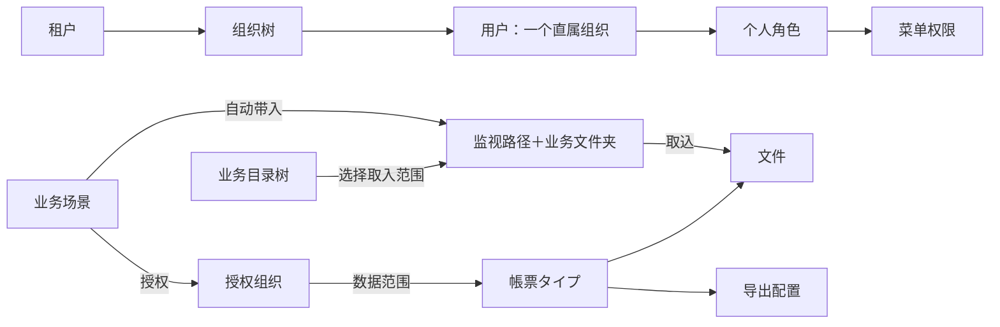
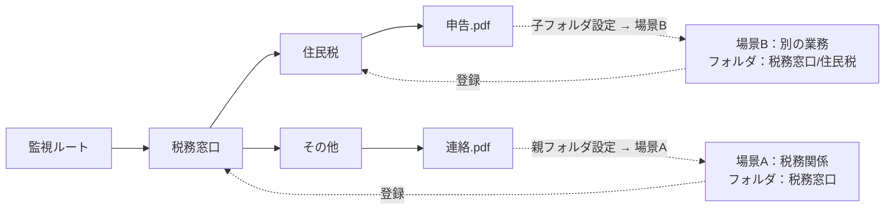

# 电算Phase1产品需求文档V1.0

## 第 1 章｜文档基础与范围

### 1.1 背景与目标

本项目在客户环境内部署 LLMOCR，沿用农林水产产品的帳票配置、识别、组织、用户和权限功能。本期定制文件一览、自动取入和 CSV 导出，并将登录账号改为用户ID。每个租户独立部署应用环境，共用 GPU 识别服务。

### 1.2 本期交付范围

| 模块 | 交付性质 | 本期范围 |
| --- | --- | --- |
| 文件一览 | 定制 | 业务场景／帳票タイプ目录、文件夹权限联动、目录名称调整、筛选、排序与批量导出 |
| 自动取入 | 全新定制 | 监视与处理后路径、组织目录递归扫描、文件名与路径正规化、自动分类与读取、去重、上传失败重试、错误记录（记录本期保存，仪表盘展示为2期） |
| 帳票タイプ | 局部定制 | 仅定制导出配置与执行规则；类别配置、OCR抽出等复用 |
| 业务场景 | 复用 | 选择组织的数据授权、场景关联类别、类别访问控制 |
| 部门与用户 | 复用与适配 | 复用组织层级、用户管理和个人角色分配；用户单一组织归属 |
| 登录 | 适配 | 用户ID＋密码登录，替换邮箱登录 |
| Home | 复用 | 沿用现有利用履历与计费能力 |
| 部署与架构 | 技术实施 | 每租户专属 VM、数据隔离、共享 GPU、多租户任务队列 |

截图用于说明页面布局和操作入口。

## 第 2 章｜数据结构与状态

### 2.1 实体与关系

- 租户拥有各自的用户、组织、业务场景、类别配置、文件和处理任务。
- 组织构成树形结构。每个用户只属于一个直属组织；上级组织查看范围可包含下级用户，成员关系始终记录直属组织。
- 用户可持有多个角色，角色授予菜单权限。菜单权限根据用户持有的角色计算。
- 菜单权限在用户处通过个人角色授予。业务画面以画面为单位授权，确认和导出包含在所属业务画面的权限内；只有设定类画面的部分项目细分追加、編集、削除。业务场景的授权组织只决定数据范围。因此同一组织内不同用户的权限可以不同。
- 业务场景关联帳票タイプ，并保存授权组织。选择组织后，默认包含该组织及下级组织的全部成员。
- 文件属于租户和帳票タイプ。文件一览按类别所属场景的授权范围显示文件。
- 每个租户 VM 配置一条监视路径和一条处理后路径。每条取入配置保存业务场景和一个或多个文件夹相对路径；每个文件夹及其全部子目录统一递归扫描 PDF／TIFF／JPEG／PNG。物理目录用于划定扫描范围。
- 导出配置属于帳票タイプ。配置包括输出列、列顺序、文本与表格字段映射、表格展开上限，以及编码和文件命名设置。

帐票类别在业务场景下维护；图中按权限链路绘制：业务场景 → 授权组织 → 帳票タイプ → 文件，授权组织决定该场景内可见和可操作的帳票タイプ与文件。自动取入配置把现有业务场景全部列出，每个场景一行、固定显示；保存值为场景ID和文件夹相对路径，データ権限組織和帳票タイプ由场景自动带出。

#### 组织、业务场景与自动取入的绑定关系

画面按现有业务场景逐行显示。无论是否已选文件夹，数据权限组织与帳票タイプ均由场景自动带出。权限组织列仅展示第一层，实际授权范围包含配置组织及其下级。文件夹按客户业务目录映射，已配置文件夹的场景参与自动取入。

| 页面 | 字段 | 候选来源 | 保存值 | 下游用途 |
| --- | --- | --- | --- | --- |
| 用户管理 | 组织 | 用户管理组织树 | 组织ID | 业务场景授权组织 |
| 业务场景设置 | 数据权限组织 | 用户管理组织树 | 组织ID列表 | 决定场景成员范围、自动取入的データ権限組織和帳票タイプ |
| 自动取入设置 | 业务场景 | 全部业务场景（固定显示） | 场景ID | 决定データ権限組織和 AI 分类候选类别 |
| 自动取入设置 | フォルダ（子フォルダを含む） | 监视路径下按业务、帳票类别组织的目录树，可展开和多选 | 相对路径列表 | 决定扫描范围 |
| 自动取入设置 | データ権限組織（下位組織含む） | 场景授权组织 | 只读展示 | 只展示第一层组织 |
| 自动取入设置 | 帳票タイプ | 该场景关联的帳票タイプ（与帳票タイプ設定菜单一致） | 仅展示 | 画面展示分类范围 |

组织映射确定扫描范围和分类上下文。AI 分类有上下文上限，候选帳票タイプ越多，提示词越长，越容易超出限制或降低判定精度；先确定业务场景后，只在该场景的帳票タイプ内比较，分类范围更窄、精度更高。AI 无法确定类别时，文件以「要確認」停在接收页，按该场景的数据权限判定可见性。来源组织用于归属、去重和归档。

#### 文件夹映射维护

自动取入的文件夹映射由客户自行维护。组织和场景发生变更后，已有文件夹映射继续保留，由客户核对和调整。

- 场景删除、改名、调整数据权限组织或帳票タイプ：保留已有文件夹映射。
- 组织删除、组织改名：文件夹路径按客户配置保留。
- 保存时仅校验：文件夹是否重复或上下级重叠、该场景是否有关联帳票タイプ。未选择文件夹时允许保存，该场景不参与自动取入。

#### 递归扫描与父子文件夹归属

每个已选文件夹都会递归扫描其全部子文件夹，PDF／TIFF／JPEG／PNG 都是取入对象。父文件夹和子文件夹分别配置给不同场景时，子文件夹内的文件采用子文件夹的配置。

- 子文件夹没有单独配置时，跟随父文件夹所属场景。
- 子文件夹单独配置给另一个场景时，该子文件夹归另一个场景，仅由匹配到的子场景取入。
- 每条文件夹路径对应一个场景，同一场景内的父子路径合并为父路径。

#### 父子文件夹分属不同场景

同一场景选中父文件夹后，子文件夹随之纳入；不同场景之间允许父/子文件夹分别映射，但禁止选完全相同的文件夹。

文件同时符合父文件夹和子文件夹的配置时，以子文件夹的配置为准：

| 配置 | 文件路径 | 归属 |
| --- | --- | --- |
| 场景A：`税務窓口`；场景B：`税務窓口/住民税` | `税務窓口/住民税/申告.pdf` | 场景B（子文件夹优先） |
| 同上 | `税務窓口/その他/連絡.pdf` | 场景A（只命中父文件夹） |

- 子文件夹内的文件由子场景独立取入。
- 父文件夹本身没有文件，且其下所有含文件的子文件夹均已配置给其他场景时，该父文件夹没有可取入文件，前端置灰且不可选择。
- 父文件夹已被选择后出现上述情况时，系统保留当前值并标记无效；用户须删除该选择，保存被阻止。
- 子文件夹所属场景无法分类该文件时，按该场景分类失败处理。
- 来源组织仍按文件夹路径推导（示例中均为「税務窓口」）；文件的閲覧/确认权限按匹配到的**场景**判定，以匹配场景的数据权限为准。
- 文件夹访问权限由客户自行维护。

## 第 3 章｜用户交互流程

### 3.1 入口与职责

管理员配置组织、用户、角色、业务场景授权、导出及自动取入。业务用户在获准访问的菜单内查看和处理场景数据。系统服务执行目录扫描、上传、读取和上传失败重试。

### 3.2 配置场景数据范围

角色：管理员。
目标：指定业务场景的数据访问组织及成员范围。

流程：

~~~text
业务场景设置 → 选择组织 → 自动包含组织成员 → 保存
~~~

1. 管理员选择组织树中的部门。
2. 系统自动包含所选组织及下级组织的全部成员。
3. 管理员保存业务场景。场景内关联类别复用现有访问控制。
4. 文件一览据此显示获准访问的文件夹和文件。
5. 组织选择改变后，系统同步更新成员范围。

### 3.3 自动取入与后续处理

角色：管理员、自动取入服务、组织业务用户。
目标：按物理目录自动接收帳票，并由有权用户处理需确认的分类。

流程：

~~~text
配置两条根路径及组织对应关系
→ 分别测试路径并保存
→ 发现新文件
→ 上传
→ 上传成功后移动源文件
→ 在组织对应的业务场景内分类
→ 自动读取或人工确认分类
→ 后端按组织＋帳票タイプ＋SHA-256 去重
→ 读取
~~~

1. 管理员配置监视根路径、处理后根路径，分别执行连接测试，再为每个组织选择监视路径下的文件夹及有权使用的业务场景。连接测试通过后方可保存。
2. 系统在当前租户 VM 的监视路径下递归发现文件，按固定规则判定扩展名、正规化路径。父文件夹和子文件夹都有配置时，系统按子文件夹的配置确定来源组织和业务场景。扫描范围自动包含该文件夹的全部子目录。
3. 系统确认文件写入完成后上传，并在所选业务场景关联的帳票タイプ内执行 AI 分类。能确定类别时进入读取；需确认时，在新规上传页等待具备「新規アップロード」画面权限、且所属组织在场景授权组织（含下级）范围内的用户确认或修改类别（候选类别限定在该业务场景内）。启动 OCR 前，后端按来源组织＋实际帳票タイプ＋内容 SHA-256 去重，重复文件跳过读取。
4. 读取结果一览的“取込”列把这批文件显示为“自動”，用户手动上传并读取的文件显示为“手動”。取入方式在读取结果一览页展示。
5. 上传成功后，系统立即将源文件移动到处理后路径，保留来源的相对目录层级。上传失败时保留源文件，按设定回数重试并记录错误；读取失败不再重试上传，只记录读取错误；移动失败时保留源文件并记录错误。

### 3.4 文件查看与导出

角色：具备相应菜单和场景数据访问权的用户。
目标：定位文件并输出业务数据。

流程：

~~~text
文件一览 → 场景／类别文件夹 → 筛选文件 → 选择格式 → 下载
~~~

1. 用户从可见文件夹或筛选条件定位文件。
2. 用户选择一个或多个文件，选择 CSV、JSON 或 PDF。
3. CSV 按类别分组，同类别多个文件合并为一个输出文件。
4. 多个输出文件统一打包为一个 ZIP；单个输出文件直接下载。
5. JSON、PDF 按输入文件分别生成输出。

### 3.5 配置帳票タイプ导出

角色：具备帳票タイプ配置权限的管理员。
目标：设置类别的导出字段、合并文件名与 CSV 编码。

流程：

~~~text
帳票タイプ设置 → 导出设置 → 保存配置 → 文件一览选择文件并导出
~~~

1. 管理员在帳票タイプ中配置输出列及表格字段展开上限，并在导出设置弹窗填写合并导出时使用的文件名和转换方式。
2. 用户导出单个文件时，输出文件默认沿用输入文件主名称，并使用目标格式的扩展名。
3. 用户导出同一类别的多个文件为 CSV 时，系统合并为一个 CSV，使用该类别配置的文件名；不同类别分别输出。
4. 系统根据最终输出文件数直接下载或打包 ZIP。

### 3.6 用户管理

1. 用户创建或编辑时选择一个所属组织，并配置个人角色。
2. 用户通过用户ID和密码登录。
3. 自动取入失败时，系统记录文件、来源路径、失败阶段和原因。

## 第 4 章｜功能详细说明

原型中的数据条数、日期、用户和处理时间用于演示，验收参数按需求确认。

### 页面总览

| 模块 | 入口 | 主要职责 | 类型 |
| --- | --- | --- | --- |
| 文件一览 | 读取结果一览 | 查询、确认、下载、删除 | 定制 |
| 自动取入 | 自動取込設定 | 监视路径、自动分类、读取、上传失败重试 | 全新 |
| 导出 | 帳票タイプ／文件一览 | 配置字段并导出 CSV、JSON、PDF | 定制 |
| 用户 | 用户管理 | 维护组织、用户和个人角色 | 复用适配 |
| 业务场景 | 业务场景设置 | 配置组织、用户和类别数据范围 | 复用适配 |
| 其他 | Home | 沿用既有能力 | 复用 |

### 4.00 新规上传页面

#### 页面与控件

| 区域 | 列／控件 | 规则 |
| --- | --- | --- |
| 上传区 | 業務シーン、拖放区、ファイル選択 | 支持 JPG、JPEG、PNG、HEIC、TIF、TIFF、PDF、ZIP；单文件最大 50MB、最多 50 页 |
| 已上传／确认待处理文件 | 文件名、大小、上传时间、用户、状态、帳票タイプ、错误原因、操作 | 展示当前用户手动上传的文件，以及用户有权访问场景内由自动取入产生的「要確認」文件 |
| 工具栏 | 選択帳票読取、一括削除 | 按选择结果和权限启用 |
| 帳票タイプ | 下拉框 | 判別中只读；要確認时可选择或修改 |

上传文件按最后一个「.」之后的后缀判断格式，后缀转为小写后比较。ZIP 解压后仅接收 JPG、JPEG、PNG、HEIC、TIF、TIFF、PDF；ZIP 文件本身不进入文件列表。

上传阶段**不做画质检测**：模糊、倾斜、分辨率不足、黑边等不作为上传拦截条件，也不触发人工确认。是否需要人工确认只由 AI 分类结果决定——能确定类别时自动读取；不能确定时以「要確認」停留。画质问题只在读取阶段作为读取失败/错误原因处理。

#### 状态与去向

| 状态 | 触发与去向 |
| --- | --- |
| 判別中 | 系统分类中；类别只读 |
| 要確認 | 等待具备「新規アップロード」画面权限、且所属组织在场景授权组织（含下级）范围内的用户选择或确认类别；候选类别为该文件所属业务场景内的帳票タイプ |
| 読取待ち | 用户点击“選択帳票読取”后进入读取 |

手动上传文件由用户启动读取；自动取入文件自动读取，需确认时停留在本页。上传页不显示其他用户手动上传的文件；自动取入仅显示当前用户有权业务场景内状态为「要確認」的文件，不受页面上方当前业务场景选择限制。自动取入文件的用户列显示「バッチ処理」。读取结果一览的“取込”列显示“自動”或“手動”。

自动取入文件由组织映射确定业务场景。分类结果不确定时，只有同时满足「所属组织在该场景授权组织（含下级）范围内」并具备「新規アップロード」画面权限的用户可见并确认。文件的来源组织只决定归属、去重范围和归档路径。

### 4.01 文件一览

| 项目 | 规则 |
| --- | --- |
| 入口 | 读取结果一览 |
| 数据范围 | 仅显示当前用户有权访问的业务场景、帳票タイプ和文件（所属组织在场景授权组织含下级内＋「読取結果一覧」菜单权限） |
| 目录 | 按业务场景／帳票タイプ展示；名称修改后同步更新 |
| 筛选 | 文件名、状态、类别、业务场景、用户、日期、OCR内容；条件取交集 |
| 状态 | 读取中、读取完成、读取失败、确认完成、已输出 |
| 操作 | 再读取、确认、下载、删除 |

| 页面 | 状态 | 触发与去向 |
| --- | --- | --- |
| 读取结果 | 读取中 | 正在执行 OCR |
| 读取结果 | 读取完成 | OCR 完成，进入确认流程 |
| 读取结果 | 读取失败 | OCR 失败，保留失败状态 |
| 读取结果 | 确认完成 | 用户完成确认，进入输出流程 |
| 读取结果 | 已输出 | 文件已完成输出 |

#### 字段与列表规格

| 区域 | 列／控件 | 规则 |
| --- | --- | --- |
| 文件树 | 业务场景、帳票タイプ | 仅显示有权数据；名称修改后同步更新 |
| 默认筛选 | 文件名、状态、帳票タイプ | 首屏显示，其余条件折叠 |
| 展开筛选 | 业务场景、创建人、处理人、OCR内容、日期 | 条件取交集；查询范围受权限限制 |
| 文件列表 | 文件名、业务场景、类别、大小、状态、取入方式、历史、创建人、处理人、时间 | 按查询结果分页 |
| 操作列 | 再读取、确认、下载、删除 | 按当前状态和权限启用 |

#### 文件树与名称、权限的联动

| 项目 | 规则 |
| --- | --- |
| 结构 | 第 1 层业务场景、第 2 层帳票タイプ、第 3 层文件；层级固定，同层只能排序 |
| 名称来源 | 文件夹名直接使用业务场景／帳票タイプ的名称；文件节点显示文件名 |
| 改名联动 | 在设定画面或文件树改名，都直接修改该业务场景／帳票タイプ的名称：文件树、筛选下拉、上传画面的帳票タイプ候选、导出默认命名、权限设置等同步更新 |
| 名称一致 | 业务场景名、帳票タイプ名与文件树文件夹名始终一致；树上改名等同于重命名，名称必填 |
| 同名禁止 | 业务场景在同一租户内唯一，帳票タイプ在同一租户内全场景唯一（含跨业务场景）；新建和改名都校验，重名时提示并保留原名称（`同じ名前は使用できません`） |
| 权限与显示 | 只显示用户数据权限内的场景／类别分支（所属组织在场景授权组织含下级＋菜单权限） |
| 权限与改名 | 改名按设定画面的菜单权限判定；改名后沿用场景／类别ID、已有权限和自动取入配置 |

#### 状态规则

| 状态 | 含义 | 后续状态 |
| --- | --- | --- |
| 读取中 | 系统正在执行 OCR | 读取完成／读取失败 |
| 读取完成 | OCR 已完成，等待确认 | 确认完成 |
| 读取失败 | OCR 未完成 | 读取中／保持失败 |
| 确认完成 | 用户已完成确认 | 已输出 |
| 已输出 | 已生成输出文件 | 保持已输出 |

### 4.02 自动取入

| 项目 | 规则 |
| --- | --- |
| 角色 | 管理员配置；系统扫描和处理；业务用户确认分类 |
| 路径 | 监视根目录、处理后根目录均必填且分别测试；测试通过后方可保存 |
| 组织配置 | 一行一个业务场景，全部固定显示；同一场景可设置多个文件夹；填写文件夹才参与取入；データ権限組織和帳票タイプ自动带出，只读；区域随内容向下延展 |
| 处理流程 | 扫描 → 上传 → 移动源文件 → 分类／人工确认 → 后端去重 → 读取 |
| 失败处理 | 上传失败按次数重试并保留源文件；读取失败只记录错误，不重试上传；移动失败保留源文件并记录 |
| 取入対象 | 仅 PDF、TIFF、JPEG、PNG；扩展名、路径和文件名按固定规则正规化后判定 |
| 关闭状态 | 路径、文件夹和执行设置置灰；已有配置保留 |

#### 字段与按钮规格

| 区域 | 字段／按钮 | 必填／状态 | 规则 |
| --- | --- | --- | --- |
| 监视路径 | 路径输入、接続テスト | 必填 | 存在且可读取；测试期间显示目录读取中间态；修改后须重新测试；未通过时保存被阻止 |
| 处理后路径 | 路径输入、接続テスト | 必填 | 存在且可写入；与监视路径分属独立目录；修改后须重新测试 |
| 业务场景配置 | 業務シーン、帳票タイプ、データ権限組織（下位組織含む）、フォルダ（子フォルダを含む） | 监视路径测试通过后可选择文件夹 | 前三列只读。业务场景列头可跳转到业务场景设置。文件夹支持多选，已选项可逐个删除 |
| 执行设置 | 执行间隔、上传再试行回数 | 开启时可编辑 | 执行间隔 1～9999；上传失败再试行 0～10；保存时校验取值范围 |
| 页面开关 | 有効／無効 | 始终可操作 | 无効时配置项置灰并保留原值 |
| 页面按钮 | 閉じる、保存 | 始终可操作 | 保存失败时保留页面输入 |

- 四个列名加粗。有业务场景设置权限时，点击「業務シーン」列名或旁边的箭头可打开「業務シーン設定」。
- 帳票タイプ与系统文件夹树使用同一套类别数据，最多显示两行。数据权限组织只显示第一层，最多显示三行。已选文件夹标签最多显示一行。各列超出时显示 `+N`，悬停可查看该列完整列表。
- 文件夹下拉按客户的业务和帳票类别展示，可展开和收起。选中父文件夹后，其全部子文件夹随之纳入，子项显示为已勾选并随父项统一操作。若先选子文件夹再选父文件夹，已选路径合并为父文件夹一项。
- 同一路径仅分配给一个场景。不同场景可分别选择父文件夹与子文件夹；子文件夹内的文件采用子文件夹对应的场景配置。
- 原型的六个业务场景各预选一个同名业务父文件夹。

路径保存、比较和画面显示使用半角反斜杠 `\`；输入兼容半角 `¥` 和全角 `￥`（以及 `/`），保存时统一为 `\`。全角 `￥` 作为输入兼容字符处理。

~~~text
来源：\\filesv01\取込\税務課\住民税\scan001.pdf
目标：\\filesv01\処理済\税務課\住民税\scan001.pdf
~~~

#### 连接测试与失败校验

连接测试（接続テスト）由服务器访问共享文件夹。监视路径测试还会读取文件夹目录，测试期间展示目录读取状态。测试结果只对当前路径有效，路径被修改后须重新测试。

| 对象 | 条件 | 显示与处理 | 日语文案 |
| --- | --- | --- | --- |
| 监视路径 | 未输入 | 显示错误；清除「有効」；阻止保存 | `パスを確認してください` |
| 监视路径 | 已发起测试，服务器尚未返回目录 | 禁用路径输入和测试按钮；显示「フォルダーを取得中…」；保留原有配置；阻止保存 | `フォルダーを取得中…` |
| 监视路径 | 连接失败或读取失败 | 同上；提示检查路径和访问权限 | `パスを確認してください` |
| 监视路径 | 可连接、可读取且目录返回成功 | 使用返回目录刷新文件夹候选；显示「有効」；组织文件夹可选择 | `フォルダーの取得が完了しました` |
| 监视路径 | 连接或目录读取失败 | 退出读取中间态；保留上次目录候选；保留原有配置；可重新测试 | `パスを確認してください` |
| 处理后路径 | 未输入、写入失败，或与监视路径相同／嵌套 | 显示错误；清除「有効」；阻止保存 | `パスを確認してください` |
| 处理后路径 | 可连接且可写入 | 显示「有効」 | `接続確認が完了しました` |
| 监视路径修改后 | 根路径发生变化 | 清除「有効」和全部场景的已选文件夹；重新测试成功后选择新根路径下的文件夹；保存被阻止直至测试通过 | — |
| 处理后路径修改后 | 处理后路径发生变化 | 清除该路径的「有効」；保留监视路径下的已选文件夹；保存被阻止直至处理后路径测试通过 | — |
| 保存（有効时） | 任一路径未测试或测试未通过 | 阻止保存，提示先执行接続テスト；保留页面输入 | `監視パスと処理後パスの接続テストを実行してください` |

#### 手动更新文件夹目录

监视路径旁的「接続テスト」同时作为首次获取和手动更新文件夹目录的入口。用户在外部新增、删除、改名、移动文件夹或调整访问权限后，可主动点击该按钮重新获取目录。

目录候选用于配置取入范围。自动取入仍按配置的执行间隔递归扫描已选路径。已选父文件夹下新增的文件和子文件夹自动纳入扫描。

同一监视根路径重新获取目录时，按完整相对路径核对已有选择。

- 路径仍存在且可访问，保留已选项。
- 路径已删除、改名、移动或无法访问，保留原路径并标记异常，提示用户重新选择。存在异常已选项时阻止保存。
- 目录获取失败，保留已有选择与上次目录候选，提示获取失败，允许重试。
- 已选父文件夹仍有效时，其下子目录增删后保留父文件夹选择。
- 监视根路径发生变化时，清空全部场景的已选文件夹。新根路径测试成功后重新选择。

首次配置且尚未测试时，文件夹候选和已选项均为空，文件夹选择禁用。已有保存配置在当前连接尚未验证时，可展示原来保存的路径并标记待验证。原型中六个场景均已选中同名父文件夹的示例应对应测试通过、目录获取成功的状态。

#### 保存时的校验

连接测试以外的输入值在保存时按以下顺序校验。命中第一个错误时显示对应消息并阻止保存，全部通过才保存。自动取入为无効时直接保存当前输入。

| 顺序 | 对象 | 条件 | 日语文案 |
| --- | --- | --- | --- |
| 1 | 监视路径 | 未输入 | `監視フォルダーを入力してください` |
| 2 | 处理后路径 | 未输入 | `処理後フォルダーを入力してください` |
| 3 | 路径关系 | 相同，或一方位于另一方之下 | `監視フォルダーと処理後フォルダーは別の階層に設定してください` |
| 4 | 组织文件夹 | 与其他场景的路径完全相同，或保存值含同一场景的冗余父子路径 | `組織フォルダーが重複しています` |
| 5 | 帳票タイプ | 场景没有绑定任何帳票タイプ | `この業務シーンの帳票タイプがありません` |
| 6 | 业务场景 | 场景授权组织（含下级）内，没有具备「新規アップロード」菜单权限的用户 | `この業務シーンのデータ権限範囲に「新規アップロード」の権限を持つユーザーがいません。権限を設定してから保存してください` |

#### 组织映射与人工确认

文件夹映射确定扫描范围与业务场景。业务场景决定 AI 分类候选和人工确认权限。

| 环节 | 规则 | 结果 |
| --- | --- | --- |
| 文件发现 | 按已选文件夹路径匹配业务场景 | 仅处理命中配置路径的文件 |
| AI 分类 | 只在该场景的帳票タイプ内分类；候选类别少，缩短 AI 上下文 | 能确定类别时直接读取 |
| 分类确认权限 | 场景数据权限（授权组织含下级）＋用户菜单权限 | 分类未定时也能判定 |
| 人工确认 | 具备「新規アップロード」画面权限且所属组织在场景授权组织（含下级）内的用户可见 | 按上述权限范围展示文件 |
| 候选类别 | 帳票タイプ下拉只显示该业务场景内的类别 | 用户选择或修改后启动 OCR |

场景授权范围包含下级组织。客户可将任意可选业务目录映射到场景，系统按匹配路径确定场景，并在该场景的帳票タイプ内进行 AI 分类。

AI 分类不确定时，文件以「要確認」停在接收页。分类确认的判定＝场景数据权限（用户所属组织在场景授权组织及下级内）∧ 菜单权限；组织决定数据范围，操作能力来自用户的菜单权限。同一场景的帳票对所有在该场景数据范围内的用户可见，文件来自哪个组织的文件夹只影响归属、去重和归档。

| 判定场景 | 权限依据 |
| --- | --- |
| 上传、分类确认 | 菜单权限＋场景数据权限 |
| 分类确定后的閲覧、修正、確認 | 菜单权限＋场景数据权限 |
| 导出 CSV／PDF | 菜单权限＋场景数据权限 |

需要按部门严格隔离时，应按组织拆分业务场景（一个场景对应一个组织）。每个场景独立配置数据权限组织和取入文件夹。

#### 权限粒度与实效权限

权限由两层组成：菜单权限（用户个人角色）和场景数据权限（场景授权组织及下级的全体用户）。菜单权限以画面为单位：新規アップロード、読取結果一覧等业务画面，只要能进入就能执行画面内的确认、导出；只有设定类画面的部分项目细分追加、編集、削除等操作权限（例如業務シーン、ユーザー管理の追加／編集／削除）。同一组织内不同用户的菜单权限可以不同。

| 项目 | 规则 |
| --- | --- |
| 菜单权限 | 个人角色；以画面为单位。业务画面进入即可操作；设定画面按需细分追加／編集／削除 |
| 场景数据权限 | 场景授权组织（含下级）内的全体用户；由组织成员关系自动决定 |
| 确认・导出 | 包含在「新規アップロード」「読取結果一覧」的画面权限内 |
| 帳票タイプ权限 | 沿用所属业务场景的数据权限 |
| 组织的角色 | 决定数据范围 |
| 实效权限 | 菜单权限 ∧ 所属组织在场景授权组织（含下级）内 |
| 同一组织内 | 菜单权限可以不同；数据范围相同 |
| 保存校验 | 场景授权组织（含下级）内至少 1 名具备对应画面菜单权限的用户 |

因此「由某个组负责确认」只是业务上的分工说法：数据范围按组织自动包含，能否操作按每个人的菜单权限判断，确认操作同时要求用户具有相应菜单权限。

#### 处理与异常规则

| 阶段 | 条件 | 系统处理 | 结果 |
| --- | --- | --- | --- |
| 扫描 | 文件写入完成 | 递归扫描已选文件夹及子目录 | 创建自动取入任务 |
| 上传 | 扫描完成 | 上传到本系统 | 成功则移动源文件；失败则按设定重试 |
| 移动源文件 | 上传成功 | 移动到处理后路径并保留相对路径 | 读取流程继续；失败则保留源文件并记录 |
| 分类 | 上传成功后 | 在场景关联类别内分类 | 自动读取或等待确认 |
| 分类确认 | 需要人工确认 | 仅向具备「新規アップロード」画面权限、且所属组织在场景授权组织内的用户展示；候选类别限定在场景内 | 确认后进入去重 |
| 去重 | 分类完成或人工确认后 | 后端按租户＋来源组织＋帳票タイプ＋内容 SHA-256 校验 | 重复则跳过读取并记录；不重复则启动 OCR |
| 读取成功 | OCR 完成 | 写入读取结果 | 进入读取结果一览 |
| 读取失败 | OCR 失败或无配置 | 记录阶段、路径和原因；文件已上传、源文件已移动 | 不重试上传，可在结果页再读取 |
| 移动失败 | 上传成功但移动失败 | 记录错误并保留源文件 | 不回退上传，按人工处理 |

| 设置 | 候选／规则 |
| --- | --- |
| 去重范围 | 租户＋来源组织（部门）＋实际帳票タイプ；以该组合为单位独立判定 |
| 防重复 | 后端固定启用，页面不提供开关和判定方式设置；前端不计算哈希、不判断重复 |
| 内容判定 | 后端计算文件内容 SHA-256；同一组合内哈希相同即视为重复，不看文件名、路径、大小 |
| 判定时机 | 分类完成或人工确认类别后、启动 OCR 前判定 |
| 归档重名 | 同一归档目录内主文件名追加序号，保留扩展名 |

同一文件名出现在不同组织（部门）的文件夹下时，系统按不同文件分别取入。例如 A 科和 B 科各自的 `scan001.pdf` 均会取入一次，读取结果一览中各自独立显示。

#### 防重复的后端实现

防重复完全在后端实现，前端只展示状态，不参与计算或判断。

- **哈希计算**：Spring Boot 在上传流中计算 SHA-256，随文件元数据保存；不依赖文件名、路径或大小。
- **去重键**：`tenant_id + source_org_id + ticket_type_id + sha256`。分类或人工确认类别后得到 `ticket_type_id`，再按该键判定。
- **唯一约束**：`ingest_dedup` 表对上述四列建唯一索引；并发扫描时先用 Redis 锁串行化同一键，最终以数据库唯一约束为准。
- **重复处理**：不创建读取任务，记录「重複スキップ」及原因；已上传的临时文件清理，源文件已在上传成功后移动，不回到监视路径。
- **非重复处理**：写入去重记录后再创建 OCR 任务；OCR 任务创建失败时保留去重记录，人工再读取不会重复取入。
- **类别变更**：人工确认修改类别后，按新类别重新判定一次；新组合重复则跳过。
- **跨组织/跨类型**：来源组织或帳票タイプ不同，即使 SHA-256 相同也分别取入。

#### 文件名与路径正规化

系统在判定扩展名、匹配取入文件夹和去重之前，先对扫描到的路径和文件名执行正规化。扩展名、大小写等正規処理項由后端固定实现。

| 项目 | 规则 | 示例 |
| --- | --- | --- |
| 取入対象の拡張子 | 仅 PDF、TIFF、JPEG、PNG 取入，对应 `.pdf`、`.tif`、`.tiff`、`.jpg`、`.jpeg`、`.png` | `scan001.pdf`、`scan002.TIF` |
| 拡張子判定 | 取最后一个「.」之后的部分，转小写后比较；无扩展名视为対象外 | `01_申告書.PDF` → `.pdf`；`scan.pdf.bak` → `.bak`（対象外） |
| 拡張子前後の空白 | 判定前去掉文件名首尾的半角空格 | `scan001.pdf `（末尾有空格）→ `.pdf` |
| 対象外ファイル | 保留源文件，后台记录错误原因和扩展名 | `.xlsx` → `対象外の拡張子（.xlsx）` |
| 路径分隔符 | 半角反斜杠 `\`、`/`、半角 `¥`、全角 `￥` 视为同一分隔符，连续分隔符合并为一个，保存统一为 `\` | `\\filesv01\取込\\税務課`、`¥¥filesv01¥取込¥税務課`、`￥￥filesv01￥取込￥税務課` 相同，保存为 `\\filesv01\取込\税務課` |
| 首尾空白与末尾分隔符 | 比较前去掉首尾空格和末尾分隔符 | `税務課\` → `税務課` |
| 大小写 | 路径、文件夹名和文件名的比较忽略大小写 | `SCAN001.PDF` 与 `scan001.pdf` 视为同一文件 |
| 上级目录引用 | 含 `.` 或 `..` 段落的路径判定为监视文件夹外并记录错误 | `..\他部署\scan.pdf` → 错误 |
| 取入文件夹匹配 | 路径按分隔符分段，从第一段起与已选路径逐段比较并忽略大小写；命中后包含全部子目录 | `税務関係\個人住民税申告` 覆盖 `税務関係\個人住民税申告\2026\scan.pdf` |
| 保存与显示 | 保存、比较和画面显示使用半角反斜杠 `\`；日文 Windows 字体可能把 `\` 显示成 `¥`，但数据仍是 `\` | 输入 `¥¥filesv01¥取込` 或 `￥￥filesv01￥取込`，保存并显示为 `\\filesv01\取込` |

错误记录本期在后台保存；2期在仪表盘展示错误记录（対象外扩展名、失败阶段、原因等）。

### 4.03 导出设置与下载

| 项目 | 规则 |
| --- | --- |
| 配置入口 | 帳票タイプ设置 → 导出设置 |
| 支持格式 | CSV、JSON、PDF |
| CSV | 按帳票タイプ合并；表格字段按最大列数横向展开 |
| 多类别导出 | 各类别分别生成文件，最终打包为 ZIP |
| 命名 | 单文件沿用原文件名；合并文件使用类别配置名称 |
| 编码 | UTF-8（含 BOM）、UTF-8（省略 BOM）、Shift_JIS |
| 权限 | 「読取結果一覧」菜单权限＋场景数据权限（授权组织含下级）；导出范围限于授权文件 |

#### CSV 数据组织

CSV 一行对应一个输入文件。文本字段和表格字段横向排列。表格按明细记录的顺序横向展开，每条记录内按配置的字段顺序输出。例如先输出“姓名1、续柄1、生年月日1、个人番号1”，再输出“姓名2、续柄2、生年月日2、个人番号2”，依次排列。

每个表格配置最大展开列数。日语界面文案为“最大列数”，说明放在注释图标中。配置上限为 N 时，固定输出 N 个展开列。实际数据不足 N 列时，剩余列保留并填空值；实际数据超过 N 列时，按原数据先后顺序输出前 N 列。例如配置为 5，实际有 3 列时输出 5 列，后 2 列为空；实际有 8 列时输出前 5 列。

同类别多个文件合并时，按配置的 N 列生成统一表头；各文件数据按该表头对齐，缺少的值填空。

批量导出 CSV 时，系统按类别分组，同类别文件合并为一个 CSV；不同类别分别采用自己的列配置。例：“10_A団体_住民異動届”的 3 个文件合并为一个 CSV，“20_B団体_住民異動届”的 7 个文件合并为另一个 CSV，最终生成 2 个 CSV，并打包为一个 ZIP。同属一个业务场景的不同帳票タイプ分别生成 CSV。

下载方式取决于最终输出的文件数：一个文件直接下载，多个文件打包为 ZIP。CSV 先按类别合并，再计算输出文件数。

#### CSV 导出示例

以下使用客户提供的世带员表格说明。原表中有 3 条已填写的人员记录，按从上到下的顺序读取。

导出时先输出第 1 条记录的全部配置字段，再输出第 2 条记录的全部配置字段，依次展开。原表一行对应一组带相同序号的导出列。

以图中配置的“氏名、続柄、生年月日、個人番号”4 个字段、最大列数 N＝3 为例，生成以下 12 列：

~~~text
第1条：氏名_1 → 続柄_1 → 生年月日_1 → 個人番号_1
第2条：氏名_2 → 続柄_2 → 生年月日_2 → 個人番号_2
第3条：氏名_3 → 続柄_3 → 生年月日_3 → 個人番号_3
~~~

上面三组列依次排列在 CSV 的同一行，实际列名加上表格名称前缀，例如“世帯員テーブル_氏名_1”。字段顺序采用客户的导出配置。

为便于阅读，下面只展示氏名和続柄两个字段的值：

~~~csv
世帯員テーブル_氏名_1,世帯員テーブル_続柄_1,世帯員テーブル_氏名_2,世帯員テーブル_続柄_2,世帯員テーブル_氏名_3,世帯員テーブル_続柄_3
小林 陸,父,小林 早苗,母,小林 望,姉
~~~

N 控制每个配置字段展开的记录数。4 个字段、N＝3 时固定生成 12 个表格字段列：实际只有 2 条记录时，第 3 组的 4 列填空；实际有 4 条记录时，输出前 3 条记录。原表中尚未填写的空白行按空值处理。

#### 多文件合并示例

同一帳票タイプ下有 3 个文件时，表头只生成一次，每个文件占一行；第 1 列固定为「入力ファイル名」，用于区分来源文件，其后是导出配置的文本字段，最后是表格字段。

以「計画書区分提出日、宛先1、住所、氏名、電話番号、メールアドレス、会社名」7 个文本字段和「世帯員テーブル」的氏名、続柄、生年月日、個人番号 4 个字段、最大列数 N＝3 为例：

示例 CSV 文件：[下载 multi-file-merge-example.csv](assets/multi-file-merge-example.csv)（UTF-8 BOM，可直接用 Excel 打开）。

下表与 CSV 的行列一致：每行一个文件，每列一个字段。表格较宽，可左右拖动查看。

| 入力ファイル名 | 計画書区分提出日 | 宛先1 | 住所 | 氏名 | 電話番号 | メールアドレス | 会社名 | 世帯員テーブル_氏名_1 | 世帯員テーブル_続柄_1 | 世帯員テーブル_生年月日_1 | 世帯員テーブル_個人番号_1 | 世帯員テーブル_氏名_2 | 世帯員テーブル_続柄_2 | 世帯員テーブル_生年月日_2 | 世帯員テーブル_個人番号_2 | 世帯員テーブル_氏名_3 | 世帯員テーブル_続柄_3 | 世帯員テーブル_生年月日_3 | 世帯員テーブル_個人番号_3 |
| --- | --- | --- | --- | --- | --- | --- | --- | --- | --- | --- | --- | --- | --- | --- | --- | --- | --- | --- | --- |
| 08_10_A団体_住民異動届_2.pdf | 千代田区長令和8年4月 | 令和8年4月 転入 | 東京都千代田区一番町1-1 | 山田 太郎 | 03-1234-5678 | yamada@example.jp |  | 小林 陸 | 父 | 1980-01-01 | 987654321 | 小林 早苗 | 母 | 1985-02-02 | 987654322 |  |  |  |  |
| 09_10_A団体_住民異動届_B2.pdf | 千代田区長令和8年4月 | 令和8年4月 転入 | 東京都千代田区一番町1-1 | 山田 太郎 | 03-1234-5678 | yamada@example.jp |  | 小林 陸 | 父 | 1980-01-01 | 987654321 | 小林 早苗 | 母 | 1985-02-02 | 987654322 |  |  |  |  |
| 01_10_A団体_住民異動届_記入済.pdf | 千代田区長令和8年4月 | 令和8年4月 転入 | 東京都千代田区一番町1-1 | 山田 太郎 | 03-1234-5678 | yamada@example.jp |  | 小林 陸 | 父 | 1980-01-01 | 987654321 | 小林 早苗 | 母 | 1985-02-02 | 987654322 |  |  |  |  |

- 第 1 列「入力ファイル名」为源文件名（含扩展名），合并后仍保留，便于追溯是哪个文件。
- 文本字段按导出配置的顺序排在表格字段之前；表格字段使用「世帯員テーブル_」前缀并加 `_1`、`_2`… 序号。
- 表头只出现一次，每个文件一行；3 个文件就是 3 行数据。
- 每个文件最多展开 N 组表格记录；不足 N 组时，剩余列填空。示例中第 3 组（氏名_3～個人番号_3）为空。
- 合并后的文件名使用该类别配置的导出名称（如 `住民異動届.csv`）。
- 不同类别分别生成各自的 CSV，最终多个文件打包为 ZIP。

同类别有多个输入文件时，每个文件各占 CSV 一行，使用相同表头。业务场景下有多个类别时，分别生成各类别的 CSV，再将多个输出文件打包为 ZIP。

#### JSON 与 PDF

JSON、PDF 的输出内容、数据结构及生成方式沿用农林水产产品。两种格式均按输入文件分别生成输出。本期定制的类别合并、横向展开和固定 N 列规则适用于 CSV。

#### 命名与编码

系统按导出对象自动确定文件名称：

- 单文件导出：默认沿用输入文件主名称，扩展名随导出格式变化。例如“申請001.pdf”导出为 CSV 时，名称为“申請001.csv”；导出为 PDF 时，名称为“申請001.pdf”。
- 同一帳票タイプ的多个文件合并导出 CSV：使用客户在该帳票タイプ中配置的导出主名称，扩展名为 .csv。
- 多个帳票タイプ批量导出：各类别分别按上述规则命名，生成的多个文件打包为 ZIP。

命名区域保留导出名称输入框，供客户配置该类别 CSV 合并导出的文件主名称。配置为空时，以帳票タイプ名称作为合并导出的文件主名称。ZIP 内存在同名文件时，在文件主名称后追加序号，保留扩展名，确保每个输出文件均被保留。

CSV 编码候选为UTF-8（含 BOM）、UTF-8（省略 BOM）及 Shift_JIS。

原型中的 PDF 为模拟输出；正式功能沿用农林水产产品。Shift_JIS 输出需验证实际编码与兼容性。

### 4.04 登录与用户ID

| 项目 | 规则 |
| --- | --- |
| 登录标识 | 用户ID＋密码 |
| 用户ID | 英文字母和数字，1～10 位；唯一性和大小写规则沿用既有产品 |
| 账号信息 | 姓名、企业名、角色、用户ID、密码修改 |
| 密码修改 | 旧密码、新密码、确认密码均必填；新密码与确认密码必须一致 |
| 退出登录 | 弹窗确认后退出；取消则留在当前页面 |

### 4.05 部门与用户

| 项目 | 规则 |
| --- | --- |
| 组织 | 复用组织树；用户仅属于一个直属组织 |
| 用户列表 | 编号、用户名、用户ID、所属组织、权限、创建时间、状态、操作 |
| 用户编辑 | 组织单选；角色在用户处配置 |
| 权限归属 | 菜单权限在用户处配置；场景授权组织只决定数据范围，同一组织内用户的权限可以不同 |
| 删除组织 | 弹窗确认；删除范围和保护规则沿用既有产品 |

#### 页面规则

| 场景 | 规则 |
| --- | --- |
| 新增部门 | 上位组织取当前节点；上位组织只读 |
| 编辑部门 | 仅可修改组织名 |
| 删除部门 | 弹窗确认；删除范围和保护规则沿用既有产品 |
| 编辑用户 | 组织单选；角色在用户处配置 |
| 变更组织 | 清除旧成员关系，建立新的唯一关系 |
| 角色变更 | 按剩余角色重新计算菜单权限 |

### 4.06 业务场景数据授权

| 项目 | 规则 |
| --- | --- |
| 配置顺序 | 选择组织 → 自动包含组织成员 → 保存 |
| 成员范围 | 所选组织及下级组织的全部成员，自动去重 |
| 保存校验 | 场景名称在同一租户内唯一，且授权组织须通过校验；所选组织内没有用户，或授权组织（含下级）内没有任何人具备「新規アップロード」或「読取結果一覧」菜单权限时，显示警告 |
| 范围变化 | 缩小组织范围时，同步更新成员范围 |
| 文件联动 | 文件查询、确认和导出必须同时满足场景数据权限（授权组织含下级）和菜单权限 |

业务场景数据范围由授权组织及其成员共同决定：选择组织后，该组织及下级的全部用户自动纳入；用户只属于一个直属组织，人员调整后数据范围随之变化。文件查询、确认和导出必须同时通过场景数据权限和菜单权限校验。

#### 帳票タイプの所属制約

一个帳票タイプ只能属于一个业务场景。

- 场景编辑的「帳票を追加」中，已绑定其他场景的类型置灰并显示「他の業務シーンで使用中」及场景名，不能选择。
- 保存时再次校验：如发现同一帳票タイプ出现在多个场景，阻止保存并提示 `この帳票タイプは「{场景名}」で使用されています`。
- 该限制适用于新增、编辑和保存；删除场景不会自动把类型转移给其他场景。

### 4.07 Home

| 项目 | 规则 |
| --- | --- |
| 内容 | 利用履历、读取枚数合计 |
| 読取枚数合計 | 検索結果に含まれるページ数の合計を表示 |
| 呼び出し方法 | 仅保留「手動アップロード」「自動取込」两种 |
| 手動アップロード | 用户在新规上传画面手动上传并启动读取；用户列为操作者 |
| 自動取込 | 自动取入服务从监视文件夹取入并自动读取；用户列为「バッチ処理」 |
| 处理 | 除取入方式外沿用既有能力；本期新增自动取入 |

### 4.08 部署与多租户

| 项目 | 规则 |
| --- | --- |
| 部署 | 每租户独立 VM、独立登录入口、配置和业务数据 |
| VM | Ubuntu 24.04 LTS；16 vCPU、32 GB 内存、2 TB |
| 服务 | Nginx、前端、后端、AI Service、MySQL、Redis、MinIO |
| 共享资源 | GPU、模型服务、向量库和任务队列 |
| 隔离要求 | 数据库、缓存、文件、队列、GPU结果和向量查询均校验租户标识 |

#### 数据保存与定期删除

- 数据保存期限沿用农林水产产品方案（7日／14日／1个月／2个月／3个月／6个月／12个月）。
- 超过保存期限后，相关文件（MinIO／共享文件夹）与 MySQL 中的记录都**物理删除**，不做逻辑删除，删除后不可恢复。
- 定期删除按租户执行。

#### 部署边界

客户架构图为本地私有化部署。每个租户使用一台独立部署的专属 VM，登录入口、配置和业务数据各自独立。每台 VM 配置一个监视根路径，递归扫描所选文件夹及其全部子目录。每条业务场景配置关联一个或多个物理文件夹，文件夹下递归扫描。VM 内部署 Nginx、Vue 3／TypeScript前端、Java／Spring Boot后端、Python／PyTorch AI Service、MySQL 8.4、Redis 7.2及 MinIO。

图示租户 VM 为 16 vCPU、32 GB 内存、2 TB，操作系统为 Ubuntu 24.04 LTS，容器化部署。

租户共享 GPU 服务器，通过多租户消息队列区分租户和调度任务。图中包含 Qwen、自信度评分、坐标抽出、图像倾斜补正、Embedding及 Qdrant。

#### 隔离与共享处理

租户专属 VM 内的数据库、缓存和文件存储分别管理。共享队列、GPU 处理中间数据和向量库按租户标识存取、校验数据。

多租户任务通过共享队列进行调度与优先度控制。GPU、模型服务和向量库在写入、查询、结果回传及删除时均校验租户。
